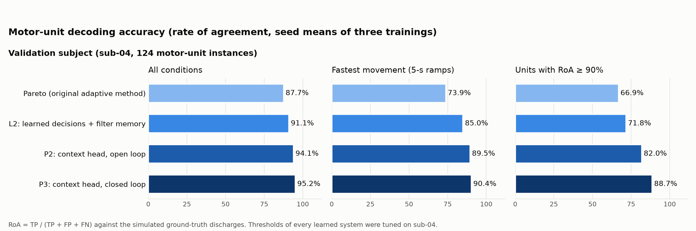
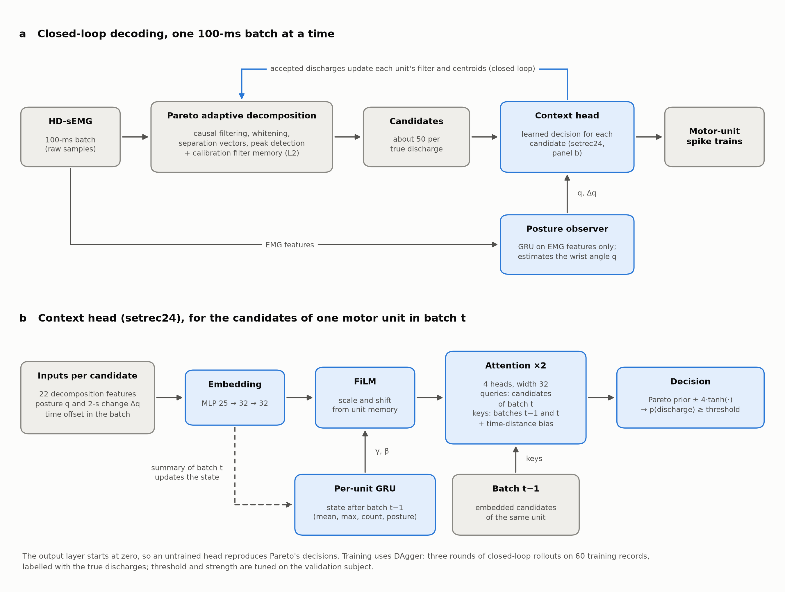
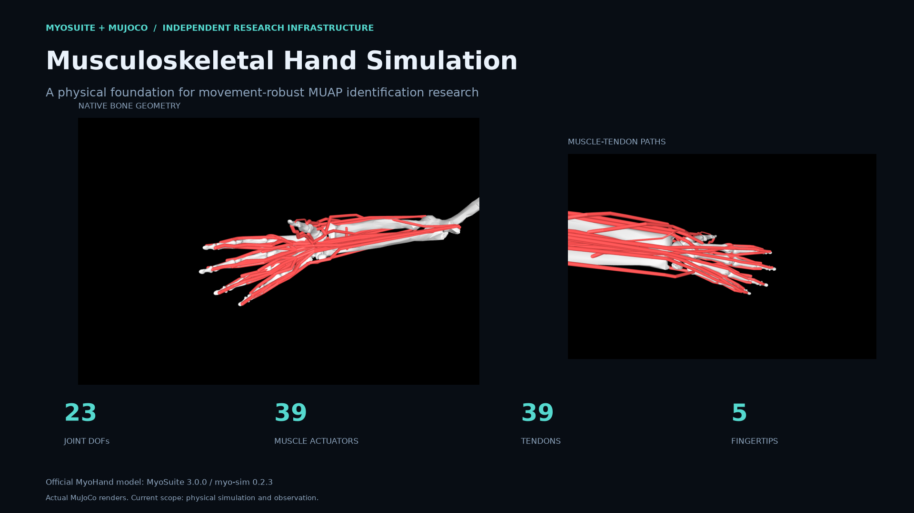
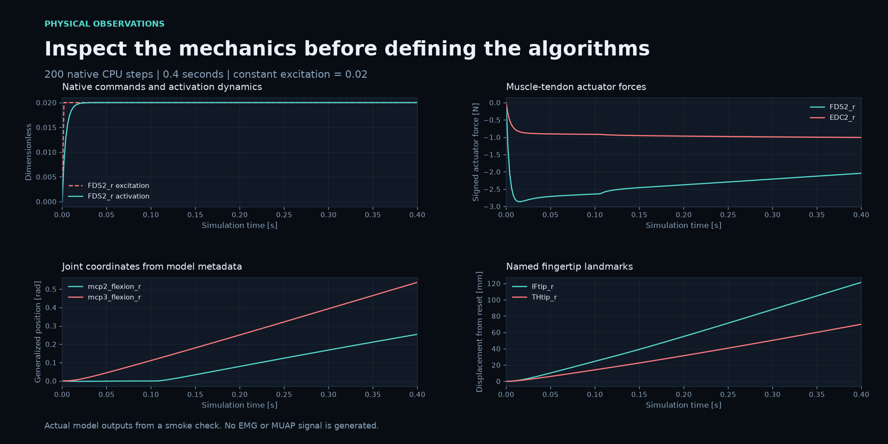
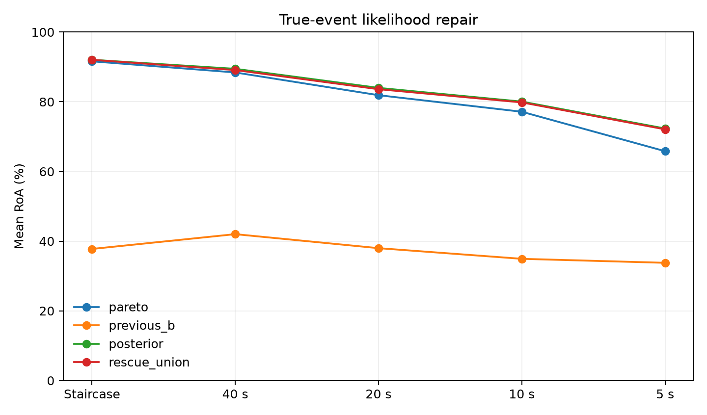

# Musculoskeletal Hand Simulation

[](https://github.com/Santiago23florido/Musculoskeletal-Hand-Simulation/actions/workflows/validate.yml)


The long-term goal of this project is to **control a hand from the activity of
individual motor units**: decode motor-unit discharges from high-density surface
EMG (HD-sEMG), turn them into movement commands, and use those commands to
drive first a simulated musculoskeletal hand and later a robotic hand.

Motor units are the smallest units of muscle control. Reading them directly
gives a much richer command signal than overall muscle activity, but today's
decomposition methods lose track of motor units when the joint moves quickly.
The first stage of the project addresses exactly that problem, alongside the
physical hand model the later stages will drive.

## Roadmap

| Stage | Goal | Status |
| --- | --- | --- |
| **1a. Musculoskeletal hand** | Load, simulate and query the MyoSuite MyoHand model in MuJoCo | **Done** |
| **1b. Motor-unit decoding during movement** | Keep identifying motor-unit discharges while the wrist moves fast | **In progress**: best result below |
| 2. From motor units to movement intent | Turn decoded discharges into per-muscle drive and joint commands | Planned |
| 3. Hand control | Drive the simulated hand, then a robotic hand, from decoded motor-unit activity | Planned |

## Current focus: decoding motor units during fast movements (Stage 1b)

The decoder is evaluated on a public simulated HD-sEMG benchmark of wrist
flexion from 0° to 40°: a staircase and triangular ramps lasting 40, 20, 10
and 5 seconds, at signal-to-noise ratios of 15 to 30 dB. Because the data are
simulated, the true discharge times are known and every decoded spike can be
scored. Subjects sub-01 to sub-03 are used for training and sub-04 for
validation. Sub-05 is held out and evaluated only once, with every system
frozen.

The starting point is the adaptive decomposition of
[Mendez Guerra, Barsakcioglu and Farina (2024)](https://doi.org/10.1088/1741-2552/ad5ebf)
in its published "Pareto" configuration. This repository keeps its update rules
and adds learned decisions about which detected peaks are true discharges.



| System (seed mean of three trainings) | All conditions | 5-s ramps | Units ≥90% | Precision | Recall |
| --- | ---: | ---: | ---: | ---: | ---: |
| Pareto, the original adaptive method | 87.65% | 73.88% | 66.94% | 96.06% | 89.03% |
| L2: learned decisions and filter memory | 91.05% | 85.01% | 71.77% | 94.95% | 94.17% |
| P2: context head, open loop | 94.06% | 89.55% | 81.99% | 96.96% | 96.52% |
| **P3: context head, closed loop** | **95.21%** | **90.38%** | **88.71%** | **97.74%** | **96.95%** |

Accuracy is the rate of agreement, `RoA = TP / (TP + FP + FN)`, on 124
motor-unit instances of the validation subject.

- The closed-loop context head (P3) **matches 95.21% of discharges across all
  conditions and 90.38% on the fastest 5-second ramps**.
- **88.71% of its motor units are tracked with an RoA of at least 90%**, against
  66.94% for the original method.
- Its gains over L2 have 95% cluster-bootstrap intervals above zero: +4.16
  points overall [2.41, 6.61] and +16.94 points in units at or above 90%
  [10.83, 24.29].
- Training in closed loop adds +1.15 points [0.43, 2.23] over the same head
  used open loop.

Every system's thresholds were tuned on sub-04, so these are development
figures. The held-out subject sub-05 gives the unbiased estimate; its results
will be added here when that single evaluation is complete. All results come
from simulated recordings.

### How the decoder works



Every 100 ms, the adaptive decomposition whitens the new EMG samples and
projects them onto one separation vector per motor unit. Peaks in each
projected source become discharge candidates, about 50 for every true
discharge. The **context head** decides which candidates are real discharges,
and the accepted ones update each unit's filter and centroids before the next
batch. Decisions therefore shape the adaptation itself: the loop is closed.

The head sees more than one candidate at a time.

- **Attention** compares each candidate with the other candidates of the same
  unit in the current and previous batch.
- **A per-unit GRU** carries the unit's recent history and posture trajectory
  from batch to batch and modulates the candidates through FiLM.
- **An EMG-only posture observer** estimates the wrist angle, so no angle
  sensor is needed at inference.

The head is trained with DAgger: it is rolled out in closed loop on the
training records, its candidates are labelled with the true discharges, and
it is retrained on the aggregated data for three rounds. Its output starts at
zero, so an untrained head reproduces the original method exactly.

**Speed is the main open limitation.** On the development laptop's CPU, one
100-ms batch currently takes a median of about 290 ms with the context head,
against about 270 ms for the original method alone. Most of that time goes to
the decomposition's own re-whitening, not to the learned head. Real-time
operation, with a 22 ms budget per batch, is not reached yet.

Method details, protocols and every intermediate level are in the
[Pareto-MC README](benchmarks/pareto_mc/README.md). The
[development journal](docs/benchmarks/pareto_mc_journal.md), in Spanish,
records each decision.

## The musculoskeletal hand (Stage 1a)



The `hand_sim` package loads the upstream model without changing its bodies,
joint constraints, tendon paths, muscle force laws, activation dynamics, or
contact parameters. It provides:

- **Working native CPU simulation** with validated muscle excitation inputs.
- **Anatomical lookup** of joints, muscles, tendons, bodies, sites, and sensors.
- Joint coordinates, muscle activations, signed actuator forces, tendon
  lengths and velocities, fingertip poses and velocities, and contact wrenches.
- Model inventories and owned physical snapshots exported as JSON or
  pickle-free NumPy archives.
- **An interactive MuJoCo viewer** showing native bones and muscle-tendon paths.

The pinned hand has **23 joint degrees of freedom, 39 muscle actuators,
39 tendons, 496 sites, and five fingertips**. It has no registered MuJoCo
sensor channels; observations are obtained from the native simulation state.
Total tendon tension and separate muscle-fiber force are not exposed as
measurement channels. See the [physical model](docs/simulation_model.md) and
[anatomical inventory](docs/anatomical_names.md) for the measurement contract.

Today the hand model and the EMG decoder are still separate. The simulation
supplies physical state and geometry, while the decoding benchmarks use
independently published simulated EMG; they do not synthesize EMG from MyoHand
and are not yet a live tracking system. Connecting decoded motor-unit activity
to the hand is the work of Stages 2 and 3.

## Install and run on Windows

Windows PowerShell is the primary development environment. Install
[uv](https://docs.astral.sh/uv/getting-started/installation/), reopen PowerShell,
and run these commands from the repository root:

```powershell
winget install --id=astral-sh.uv -e
$env:UV_PROJECT_ENVIRONMENT = '.venv-windows'
uv sync --locked --python 3.12
uv run --locked python scripts/run_simulation.py --steps 200 --output outputs/smoke.npz
uv run --locked python scripts/inspect_model.py --output outputs/model_inventory.json
uv run --locked python scripts/visualize_hand.py
```

Alternatively, after installing uv, run the setup script to prepare and validate
the native Windows environment:

```powershell
powershell -ExecutionPolicy Bypass -File scripts/setup_windows.ps1 -Validate
```

Python 3.12 is downloaded by uv when needed. The physical simulation needs no
GPU or CUDA toolkit. The viewer needs a desktop and an OpenGL-capable driver;
headless simulation does not open a window. Rotate by dragging, scroll to zoom,
and close the viewer to stop.

Keep `UV_PROJECT_ENVIRONMENT` set in each PowerShell session. Windows uses
`.venv-windows`; a separate `.venv` can be used under WSL. Once installed,
`.\.venv-windows\Scripts\python.exe scripts/visualize_hand.py` also works directly.

The headless example applies a constant native excitation of `0.02` to all
muscle actuators. It verifies physics execution; it does not implement a
movement task or learned controller.

## Python API

```python
import numpy as np
from hand_sim import load_model
from hand_sim.state import save_states

with load_model("configs/simulation.yaml") as sim:
    initial = sim.reset()
    current = sim.step(np.full(sim.model.nu, 0.02))
    joint = sim.get_joint_state("mcp2_flexion_r")
    muscle = sim.get_muscle_state("FDS2_r")
    fingertip = sim.get_site_position("IFtip_r")
    velocity = sim.get_site_velocity("IFtip_r")
    inventory = sim.get_model_inventory()
    save_states("outputs/query.npz", [initial, current], metadata=sim.provenance)
```

Queries return owned copies, and invalid names raise `KeyError`. `step()` accepts
a finite vector of length `model.nu` within the model's native control limits
(`[0, 1]` here). It advances one native `0.002`-second step by default; omitting
the vector holds previous commands. `substeps` changes the number of native
steps. This API steps MuJoCo directly and does not compute Gym rewards or
episode termination.

Additional methods include `get_state()`, `get_tendon_state()`,
`get_body_state()`, `get_contacts()`, and `get_sensor_data()`. Native objects are
available as `sim.model` and `sim.data`. Call `mujoco.mj_forward` after direct
state edits before reading dependent quantities.

Saved snapshots load with `np.load("outputs/smoke.npz", allow_pickle=False)`.
They contain observations and provenance rather than complete restart states.



## Other decoding approaches explored

The context head is the latest of several approaches tried in Stage 1b. Each
workflow has its own README with commands, protocol, scoring and limits.
Results from different rows use different record sets, so compare numbers only
within a row's own documentation.

| Workflow | Approach | Outcome |
| --- | --- | --- |
| [Farina references](benchmarks/farina/README.md) | Reproduction of the published adaptive method and its benchmark | All 28 published Table 2 values reproduced within one point; tutorial RoA 90.25% |
| [Pareto-MC](benchmarks/pareto_mc/README.md) | Learned discharge decisions inside the adaptive loop, EMG-only posture, filter memory, context heads | **Best result: 95.21% RoA on the validation subject (P3, above)** |
| [Spike likelihood](benchmarks/spike_likelihood/README.md) | Shared classifier of discharge candidates, without angle inputs | 83.51% vs 80.89% for Pareto on 80 outer-subject records; 72.33% vs 65.81% on 5-s ramps |
| [Pareto residual](benchmarks/pareto_residual/README.md) | Bounded correction of the adaptation steps, conditioned on the measured wrist angle | 81.69% vs 80.89% on the same 80 records |
| [Template rescue](benchmarks/template_rescue/README.md) | Analytic multichannel templates that recover dormant units | 81.42% on the same 80 records; recovers 511 retained unit instances |
| [Stage A](benchmarks/stage_a/README.md) | Causal encoder with a low-rank whitening correction | 57.83% vs 79.25% for Pareto on 100 records |
| [Stage B MoCA](benchmarks/stage_b/README.md) | Shared FiLM morphing of MUAP templates with a state observer | 37.26% vs 80.89% for Pareto |
| [Separation](benchmarks/stage_b_separation/README.md) and [geometry](benchmarks/stage_b_geometry/README.md) pilots | Covariance-aware source loss; physical template warping | Stopped during validation |
| [Robust MVDR](benchmarks/robust_mvdr/README.md) | Training-free analytic decoding | Withdrawn after an amplitude defect was found; see the [correction](docs/benchmarks/robust_mvdr_correction.md) |

The ideas that worked were kept and combined. The spike-likelihood study showed
that learning which candidates are discharges pays off, and Pareto-MC moved
that decision inside the adaptive loop. Approaches that replaced the
decomposition itself (Stage A, Stage B) fell well short of the original method.
An [independent review](docs/benchmarks/independent_review.md) documents scoring
details, such as how the reference code defines movement phases.



## Running the EMG benchmarks

Benchmarks run separately from `hand_sim`; do not install their numerical stack
into the simulation environment. Start with the pinned reference setup:

```powershell
powershell -NoProfile -ExecutionPolicy Bypass -File benchmarks/farina/setup.ps1 -Fdsi
.\.venv-benchmarks\Scripts\python.exe benchmarks/farina/download.py fdsi-data
.\.venv-benchmarks\Scripts\python.exe benchmarks/farina/download.py fdsi-outputs
uv pip install --python .venv-benchmarks/Scripts/python.exe --requirement benchmarks/stage_a/requirements.lock.txt
.\.venv-benchmarks\Scripts\python.exe -m pytest -q benchmarks
```

The two FDSI archives total approximately 21.1 GB before extraction. Downloads
verify the published checksums. The setup script pins the reference code in
`external/farina/`; each benchmark README documents its subsequent commands.
CUDA training uses a separate environment and the Stage B GPU requirements;
benchmark inference and timing use the CPU environment.

Tracked `docs/benchmarks/` files contain compact result summaries, protocols,
audits, and per-unit tables. Large signals, downloaded implementations,
checkpoints, predictions, environments, and generated runtime outputs stay
local in Git-ignored directories. Use a fresh output directory for each new run,
so that frozen experiments and their source checks are preserved.

## Project layout

```text
src/hand_sim/          Physical simulation and anatomical query API
configs/              Reproducible simulation defaults
scripts/              Setup, inspection, simulation, viewer, and figure commands
tests/                Physical model and observation tests
benchmarks/           Optional EMG experiments and their tests
docs/benchmarks/       Recorded benchmark results, protocols, and audits
docs/images/           Model renders and benchmark figures
LICENSES/             Third-party license texts
```

## Validation

```powershell
$env:UV_PROJECT_ENVIRONMENT = '.venv-windows'
uv run --locked pytest -q
uv run --locked ruff check src scripts tests benchmarks
uv run --locked ruff format --check src scripts tests benchmarks
.\.venv-benchmarks\Scripts\python.exe -m pytest -q benchmarks
```

The physical tests check upstream biomechanical arrays, at least 200 simulation
steps, reset behavior, excitation validation, anatomical identifiers, contacts,
sensor slicing, fingertip velocities, and export round trips. Benchmark tests
cover numerical identities, gradients, causality, data separation, spike
scoring, download integrity, and evaluation acceptance rules. Graphics and CUDA
tests skip when their required display or device is unavailable.

[GitHub Actions](.github/workflows/validate.yml) runs physical validation on
Windows and Ubuntu. See the [original platform validation](docs/validation.md)
and [publication validation](docs/publication_validation.md) for local results.
Regenerate the model figures with
`uv run --locked python scripts/render_readme_assets.py` on a desktop with OpenGL,
and the decoder figures with
`.\.venv-benchmarks\Scripts\python.exe scripts/render_pareto_mc_figures.py`.

## Ubuntu / WSL2

With uv installed in Ubuntu, use a separate Linux environment:

```bash
sudo apt-get update
sudo apt-get install -y libgl1 libglfw3 libegl1 libosmesa6
uv sync --locked --python 3.12
uv run --locked python scripts/run_simulation.py --steps 200
uv run --locked pytest -q
uv run --locked python scripts/visualize_hand.py
```

The interactive viewer requires WSLg or another working graphical display.
Headless physics needs no GPU. Keep Windows and Linux environments separate.

## Sources and licenses

The model comes from [MyoSuite](https://github.com/MyoHub/myosuite) 3.0.0 and
[myo-sim](https://github.com/MyoHub/myo_sim) 0.2.3, with MuJoCo 3.16.0.
Simulation dependencies are pinned in `uv.lock`; benchmark locks are stored
alongside their workflows.

This repository's independent code uses the [MIT license](LICENSE). Upstream
components retain their licenses and attribution. See
[third-party notices](THIRD_PARTY_NOTICES.md),
[benchmark provenance](benchmarks/farina/sources.json),
[references](docs/references.md), and [CITATION.cff](CITATION.cff).

At the owner's request, publication commits use retrospective author and
committer dates. This batch was organized and validated on **19 October 2026**,
with commit dates distributed from the repository's creation on **15 October**
through **19 October**. Earlier implementation commits already used dates
starting on 1 October, as recorded before this publication. The existing history
is preserved; commit dates do not establish when experiments were executed.
