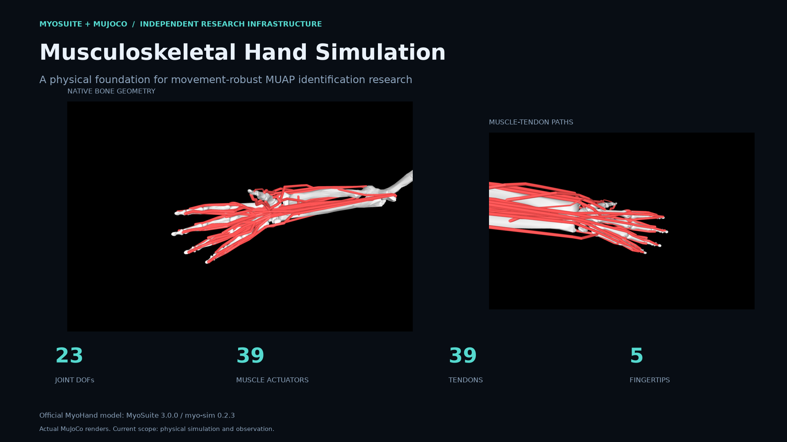
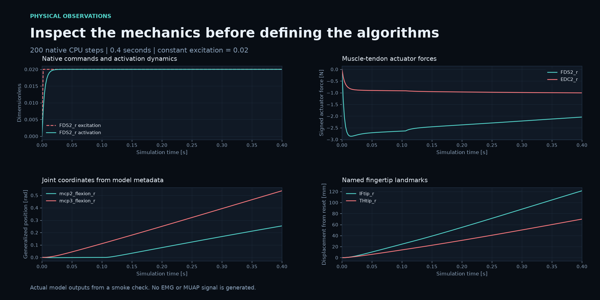
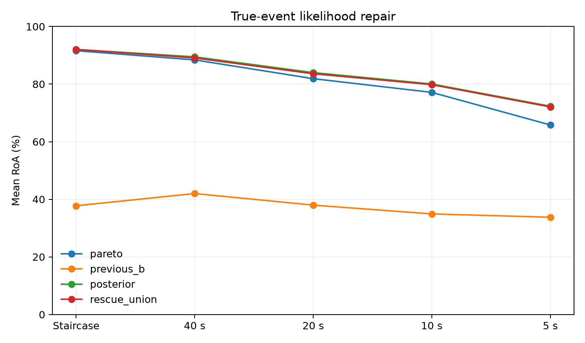

# Musculoskeletal Hand Simulation

[](https://github.com/Santiago23florido/Musculoskeletal-Hand-Simulation/actions/workflows/validate.yml)


A Python workspace for inspecting the **official MyoSuite MyoHand model** and
researching motor-unit discharge identification in EMG during hand movement.
The current implementation includes a working musculoskeletal simulation,
anatomical queries, a MuJoCo viewer, and separate EMG research benchmarks with
recorded results, including unsuccessful experiments.



## What is implemented

The `hand_sim` package loads the upstream model without changing its bodies,
joint constraints, tendon paths, muscle force laws, activation dynamics, or
contact parameters. It provides:

- Native CPU simulation with validated muscle excitation inputs.
- Anatomical lookup of joints, muscles, tendons, bodies, sites, and sensors.
- Joint coordinates, muscle activations, signed actuator forces, tendon
  lengths and velocities, fingertip poses and velocities, and contact wrenches.
- Model inventories and owned physical snapshots exported as JSON or
  pickle-free NumPy archives.
- An interactive MuJoCo viewer showing native bones and muscle-tendon paths.

The pinned hand has **23 joint degrees of freedom, 39 muscle actuators,
39 tendons, 496 sites, and five fingertips**. It has no registered MuJoCo
sensor channels; observations are obtained from the native simulation state.
Total tendon tension and separate muscle-fiber force are not exposed as
measurement channels. See the [physical model](docs/simulation_model.md) and
[anatomical inventory](docs/anatomical_names.md) for the measurement contract.

The simulation supplies physical state and geometry. The optional `benchmarks/`
workflows use independently published simulated EMG recordings; they do not
synthesize EMG from MyoHand or establish a live tracking system.

## Install and run on Windows

Windows PowerShell is the primary development environment. Install
[uv](https://docs.astral.sh/uv/getting-started/installation/), reopen PowerShell,
and run these commands from the repository root:

```powershell
winget install --id=astral-sh.uv -e
$env:UV_PROJECT_ENVIRONMENT = '.venv-windows'
uv sync --locked --python 3.12
uv run --locked python scripts/run_simulation.py --steps 200 --output outputs/smoke.npz
uv run --locked python scripts/inspect_model.py --output outputs/model_inventory.json
uv run --locked python scripts/visualize_hand.py
```

Alternatively, after installing uv, run the setup script to prepare and validate
the native Windows environment:

```powershell
powershell -ExecutionPolicy Bypass -File scripts/setup_windows.ps1 -Validate
```

Python 3.12 is downloaded by uv when needed. The physical simulation needs no
GPU or CUDA toolkit. The viewer needs a desktop and an OpenGL-capable driver;
headless simulation does not open a window. Rotate by dragging, scroll to zoom,
and close the viewer to stop.

Keep `UV_PROJECT_ENVIRONMENT` set in each PowerShell session. Windows uses
`.venv-windows`; a separate `.venv` can be used under WSL. Once installed,
`.\.venv-windows\Scripts\python.exe scripts/visualize_hand.py` also works directly.

The headless example applies a constant native excitation of `0.02` to all
muscle actuators. It verifies physics execution; it does not implement a
movement task or learned controller.

## Python API

```python
import numpy as np
from hand_sim import load_model
from hand_sim.state import save_states

with load_model("configs/simulation.yaml") as sim:
    initial = sim.reset()
    current = sim.step(np.full(sim.model.nu, 0.02))
    joint = sim.get_joint_state("mcp2_flexion_r")
    muscle = sim.get_muscle_state("FDS2_r")
    fingertip = sim.get_site_position("IFtip_r")
    velocity = sim.get_site_velocity("IFtip_r")
    inventory = sim.get_model_inventory()
    save_states("outputs/query.npz", [initial, current], metadata=sim.provenance)
```

Queries return owned copies, and invalid names raise `KeyError`. `step()` accepts
a finite vector of length `model.nu` within the model's native control limits
(`[0, 1]` here). It advances one native `0.002`-second step by default; omitting
the vector holds previous commands. `substeps` changes the number of native
steps. This API steps MuJoCo directly and does not compute Gym rewards or
episode termination.

Additional methods include `get_state()`, `get_tendon_state()`,
`get_body_state()`, `get_contacts()`, and `get_sensor_data()`. Native objects are
available as `sim.model` and `sim.data`. Call `mujoco.mj_forward` after direct
state edits before reading dependent quantities.

Saved snapshots load with `np.load("outputs/smoke.npz", allow_pickle=False)`.
They contain observations and provenance rather than complete restart states.



## EMG research benchmarks

The research goal is movement-robust identification of motor unit action
potentials (MUAPs) and their discharges. The current benchmarks investigate
adaptation, template morphing, and event detection on the authors' FDSI data.
Each workflow has its own commands, protocol, scoring, and documented limits.

| Workflow | Implemented approach | Recorded outcome |
| --- | --- | --- |
| [Farina references](benchmarks/farina/README.md) | Pinned adaptive tutorial, spike scoring, detector ablation, and cached FDSI reproduction | Tutorial adaptive RoA: 90.25%; all 28 cached Table 2 comparisons pass the one-point tolerance. |
| [Stage A](benchmarks/stage_a/README.md) | Causal encoder and invertible low-rank whitening correction | 57.83% mean RoA versus Pareto's 79.25% on 100 records; **no-go**. |
| [Pareto residual](benchmarks/pareto_residual/README.md) | Bounded calibration-conditioned correction with 97 shared parameters; two inputs are the measured wrist angle and its velocity | 81.69% versus 80.89% on 80 outer records; rapid-movement targets unmet, **no-go**. |
| [Template rescue](benchmarks/template_rescue/README.md) | Analytic multichannel directions, dormant-unit recovery, and Pareto fallback | 81.42% on the same 80 records; restores 511 final retained instances, **no-go**. |
| [Stage B MoCA](benchmarks/stage_b/README.md) | Shared FiLM MUAP morphing and an EMG-only state observer | MoCA-B: 37.26%, MoCA-K: 36.97%, versus Pareto's 80.89%; **no-go**. |
| [Separation pilot](benchmarks/stage_b_separation/README.md) | Covariance-aware source loss and MVDR normalization | Stopped during validation; no outer-test predictions. |
| [Geometry pilot](benchmarks/stage_b_geometry/README.md) | Shared physical template warping | Stopped during validation; no outer-test predictions. |
| [Spike likelihood](benchmarks/spike_likelihood/README.md) | Bounded shared classifier of discharge candidates, without angular inputs | **83.51% versus 80.89%**; 72.33% versus 65.81% on 5-second ramps; full thresholds still **no-go**. |
| [Robust MVDR](benchmarks/robust_mvdr/README.md) | Training-free analytic decoding, with phase, target-reliability and frozen-checkpoint audits | static_subtract: **5.22%** versus Pareto's 80.89% on the same 80 records; [diagnostic result](docs/benchmarks/robust_mvdr_diagnostic.md), not independent confirmation. |

Phase metrics follow the reference `get_triangular_phases`: for triangular
conditions the reported "first hold" spans 0–10 s, while it is the 5 s calibration
hold in the staircase. The triangular "first hold" RoA falls with ramp speed for
every method (Pareto: 98.3% at 40 s ramps, 73.5% at 5 s ramps), which indicates
that this window contains movement after the 5 s calibration hold. Verify with
`python -m benchmarks.robust_mvdr.run phase-audit` before interpreting
"first hold" differences; see the [independent review](docs/benchmarks/independent_review.md).

RoA is `TP / (TP + FP + FN)` and differs from F1. The tutorial evaluates a
separate example and window. Stage A uses 100 records; later outer-subject
experiments use the same 80 records and 591 calibrated instances. Comparisons
must preserve these populations and scoring protocols.

The spike-likelihood result improves recall from 83.16% to 87.74%, while
precision falls from 91.47% to 91.10%. It demonstrates an event-detection gain on
this benchmark. Independent-generator transfer, true MUAP-trajectory recovery,
and full live-stream latency remain unverified. See the
[published summary](docs/benchmarks/spike_likelihood_summary.json) and
[analysis](docs/benchmarks/spike_likelihood_analysis.json).



### Benchmark environments and data

Benchmarks run separately from `hand_sim`; do not install their numerical stack
into the simulation environment. Start with the pinned reference setup:

```powershell
powershell -NoProfile -ExecutionPolicy Bypass -File benchmarks/farina/setup.ps1 -Fdsi
.\.venv-benchmarks\Scripts\python.exe benchmarks/farina/download.py fdsi-data
.\.venv-benchmarks\Scripts\python.exe benchmarks/farina/download.py fdsi-outputs
uv pip install --python .venv-benchmarks/Scripts/python.exe --requirement benchmarks/stage_a/requirements.lock.txt
.\.venv-benchmarks\Scripts\python.exe -m pytest -q benchmarks
```

The two FDSI archives total approximately 21.1 GB before extraction. Downloads
verify the published checksums. The setup script pins the reference code in
`external/farina/`; each benchmark README documents its subsequent commands.
CUDA training uses a separate environment and the Stage B GPU requirements;
benchmark inference and timing use the CPU environment.

Tracked `docs/benchmarks/` files contain compact result summaries, protocols,
audits, and per-unit tables. Large signals, downloaded implementations,
checkpoints, predictions, environments, and generated runtime outputs remain
local under Git-ignored directories. PDF guides, agent instructions, and internal
research notes are also ignored. Public READMEs and result documentation remain
versioned. The local research PDF is optional provenance: new run manifests
record `null` for its hash when it is absent. Archived reports retain their
original values. Use fresh output directories for new runs so existing frozen
experiments and their source checks are preserved.

## Project layout

```text
src/hand_sim/          Physical simulation and anatomical query API
configs/              Reproducible simulation defaults
scripts/              Setup, inspection, simulation, viewer, and figure commands
tests/                Physical model and observation tests
benchmarks/           Optional EMG experiments and their tests
docs/benchmarks/       Recorded benchmark results, protocols, and audits
docs/images/           Model renders and benchmark figures
LICENSES/             Third-party license texts
```

## Validation

```powershell
$env:UV_PROJECT_ENVIRONMENT = '.venv-windows'
uv run --locked pytest -q
uv run --locked ruff check src scripts tests benchmarks
uv run --locked ruff format --check src scripts tests benchmarks
.\.venv-benchmarks\Scripts\python.exe -m pytest -q benchmarks
```

The physical tests check upstream biomechanical arrays, at least 200 simulation
steps, reset behavior, excitation validation, anatomical identifiers, contacts,
sensor slicing, fingertip velocities, and export round trips. Benchmark tests
cover numerical identities, gradients, causality, data separation, spike
scoring, download integrity, and evaluation acceptance rules. Graphics and CUDA
tests skip when their required display or device is unavailable.

[GitHub Actions](.github/workflows/validate.yml) runs physical validation on
Windows and Ubuntu. See the [original platform validation](docs/validation.md)
and [publication validation](docs/publication_validation.md) for local results.
Regenerate the model figures with
`uv run --locked python scripts/render_readme_assets.py` on a desktop with OpenGL.

## Ubuntu / WSL2

With uv installed in Ubuntu, use a separate Linux environment:

```bash
sudo apt-get update
sudo apt-get install -y libgl1 libglfw3 libegl1 libosmesa6
uv sync --locked --python 3.12
uv run --locked python scripts/run_simulation.py --steps 200
uv run --locked pytest -q
uv run --locked python scripts/visualize_hand.py
```

The interactive viewer requires WSLg or another working graphical display.
Headless physics needs no GPU. Keep Windows and Linux environments separate.

## Sources and licenses

The model comes from [MyoSuite](https://github.com/MyoHub/myosuite) 3.0.0 and
[myo-sim](https://github.com/MyoHub/myo_sim) 0.2.3, with MuJoCo 3.16.0.
Simulation dependencies are pinned in `uv.lock`; benchmark locks are stored
alongside their workflows.

This repository's independent code uses the [MIT license](LICENSE). Upstream
components retain their licenses and attribution. See
[third-party notices](THIRD_PARTY_NOTICES.md),
[benchmark provenance](benchmarks/farina/sources.json),
[references](docs/references.md), and [CITATION.cff](CITATION.cff).

At the owner's request, publication commits use retrospective author and
committer dates. This batch was organized and validated on **19 October 2026**,
with commit dates distributed from the repository's creation on **15 October**
through **19 October**. Earlier implementation commits already used dates
starting on 1 October, as recorded before this publication. The existing history
is preserved; commit dates do not establish when experiments were executed.
