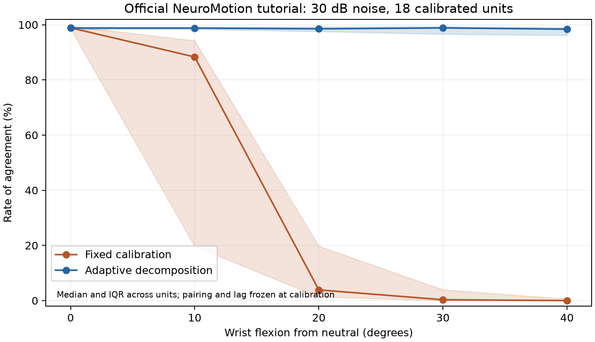

# Farina references for EMG decomposition during movement

The research report's **weeks 1–2 FDSI reproduction** has a
[separate log](../../docs/benchmarks/fdsi_weeks_1_2.md). `setup.ps1 -Fdsi`
prepares its dependencies; `reproduce_fdsi.py` checks all 100 records and
recomputes RoA for the four Table 2 comparators from published outputs.
The log records that run separately from the tutorial below.
**The 18 October 2026 run reproduced all 400 results**, with 768 instances per
method, zero differences from saved RoA, and all 28 Table 2 values within
±1 percentage point (maximum difference: 0.0544).

Local research and tutorial execution took place on **16 October 2026**.
**The public adaptive-method example was reproduced.** Full reproduction of
both papers remains pending because of the access limits below. Observed
values are in the [execution record](../../docs/benchmarks/farina_tutorial_summary.json).

## The two methods

| Method and implementation | Movement, data, and noise | Access at the time of review |
| --- | --- | --- |
| **HarmonICA / Quasi-Linear ICA**, Clarke et al., [arXiv:2406.19581v2](https://arxiv.org/html/2406.19581v2), 9 May 2026. Invertible low-rank compensator, rank 3 in the main configuration, ICA separation, and sequential extraction. | NeuroMotion + BioMime through MUniverse. Sinusoidal and triangular sweeps of **±32.5° or ±65°**, 0.3 Hz, 50% MVC, **20/25 dB SNR**. Records of 10 s at 2048 Hz; 70- and 320-channel grids. Test set: 21 pools, 5 simulated subjects, 336 records, plus 80 validation records. | The [repository linked in the paper](https://github.com/AlexKClarke/harmonica_2026) returned **404** through both Git and the GitHub API and was absent from the author's public repository list. Its code and modified benchmark were unavailable. |
| **Adaptive EMG decomposition**, Mendez Guerra, Barsakcioglu, and Farina, [JNE 2024, 21 046023](https://doi.org/10.1088/1741-2552/ad5ebf), [official code](https://github.com/imendezguerra/adapt_decomp). Whitening, separation-vector, and peak-detection adaptation, with KL and kurtosis criteria. | The paper simulates **−40° to +40°**, with separate flexion and extension from 0°, 10° steps, 30 s holds, and 10 s ramps (**1°/s**). It uses 100 FDS motor neurons, constant 15% excitation, a 10×32 grid, and 2048 Hz sampling. **Zero-mean Gaussian noise, 30 dB SNR**. Ten resamplings × two conditions = 20 contractions. | Code and one flexion example were available. The paper states that the full data are available on request from the authors. |

These blind/unsupervised separation methods recover **motor-unit discharges and
spike trains**. This does not automatically recover a MUAP waveform library
with known error. HarmonICA v1 (2024) predates v2's low-rank protocol; their
datasets, objectives, and results must be kept distinct.

## Signal provenance

In the adaptive protocol, **NeuroMotion** combines Fuglevand's recruitment and
discharge-rate model, an upper-limb musculoskeletal model in **OpenSim**, and
**BioMime**, a generative volume-conductor model. Fiber-length changes inform
depth and conduction velocity under a constant-muscle-volume assumption.
BioMime generates or modifies MUAPs with posture; discharge trains are combined
with those MUAPs to synthesize EMG, then noise is added. See section 2.1 of the
[full paper at Imperial](https://spiral.imperial.ac.uk/server/api/core/bitstreams/875e0afe-7025-4350-aee2-6feee0672b71/content).

This reproduction uses the authors' distributed noisy signals. It does not
generate new MyoHand data. The 30 dB value comes from the protocol and archive
README; it was not remeasured because the example lacks its clean signal.
The decomposition code does not receive true discharge labels during
adaptation; those labels are used for evaluation.

The [official example archive](https://doi.org/10.5281/zenodo.22880910) contains
190 s of EMG, 320 channels, and simulated true spike trains for 100 neurons
(56 active). The supplied MATLAB calibration contains **18 units**, uses the
first 30 s, and has an extension factor of **3**. That calibration is reused;
its original MATLAB estimation was not reproduced. The HDF5 `muaps` variable
has an empty first axis, so the complete simulated MUAP library is absent.
Estimated MUAPs in the MAT file cannot replace that ground truth.

The same repository publishes a **later FDSI benchmark**, distinct from the
original 20 records: 5 subjects × 5 conditions × 4 SNR levels = 100 records,
100 channels, wrist movement from 0° to 40°, and SNR **30/25/20/15 dB**, with
clean and noisy signals. It includes staircase and 40/20/10/5 s triangular
ramps. Archives contain [data, 10.35 GB](https://doi.org/10.5281/zenodo.22882346)
and [precomputed outputs, 10.75 GB](https://doi.org/10.5281/zenodo.22882323).
The notebooks distinguish supervised RoA tuning from selection by unsupervised
criteria; those results must be labeled separately. The 100 cases were neither
downloaded nor executed in the 16 October tutorial reproduction. The later FDSI
run is documented in the log linked at the beginning.

## Measured results and comparator configuration

`adapt_decomp` was pinned to **8ffeb66ebd30bab9b5167a3fc485c2330a81da0f**, before
the September 2026 rewrite. That revision's notebook contains the saved results
below. Its algorithm ran unchanged on CPU with four threads, seed 0,
`compute_loss=False`, and independent copies of the same calibration for each
method.

| RoA over the full 190 s | Notebook: mean / median | Local run: mean / median |
| --- | --- | --- |
| Full adaptation | 90.25% / 98.58% | **90.2497% / 98.5839%** |
| Fully fixed (`adapt_wh=False`, `adapt_sv=False`, `adapt_sd=False`) | Labeled as reference: 44.31% / 39.37% | 37.7210% / 37.0300% |
| Fixed filters, adaptive detection (`False`, `False`, `True`) | Saved comparator: 44.31% / 39.37% | **44.3092% / 39.3668%** |

**Full adaptation matches the notebook's rounded values.** The saved comparator
is reproduced when only detection adapts, although the notebook's current
cells disable all three flags. This was isolated by applying the original
detector to projections from the fixed run, without recomputing or changing
filters. The [check record](../../docs/benchmarks/farina_detection_ablation.json)
retains configuration and numerical differences. This reproduces the numbers
without proving the historical kernel state that saved them. The fully fixed
condition retains its separate result.

EMG in the MAT file was also verified identical to the first 30 s of the HDF5.
Matching from either MATLAB peaks or the initial fixed run gives the same
18 identities and lags, without tuning against evaluation-window labels.

For future comparisons, independent metrics are also computed over **30–190 s**,
excluding calibration from scoring. Identities and lags are frozen from
calibration, with ±2 ms tolerance and one-to-one matching:

| Method | Mean RoA | Mean F1 |
| --- | --- | --- |
| Fixed | 27.2799% | 39.0309% |
| Adaptive | **87.6349%** | **91.2043%** |

The notebook realigns each pair when evaluating the full record; independent
evaluation freezes that lag at calibration. The two evaluations therefore have
separate names and files. RoA = TP/(TP+FP+FN), while F1 = 2TP/(2TP+FP+FN);
their percentages are not interchangeable. Legacy code centers using the full
record mean. This run preserves that behavior and does not establish complete
causal processing. Local timing also cannot replace the paper's hardware
benchmark.



Across its full dataset, the 2024 paper reports median RoA of **98.10% versus
35.86%**, precision of **99.92% versus 62.61%**, and sensitivity of **98.21% versus
36.46%** (adaptive versus fixed, section 3.1). **Those aggregate results have not
been reproduced here.** NMSE, PNR, results from the nine participants, and
HarmonICA v2 tables also remain unreproduced.

## Repeat on Windows

Run from the repository root:

```powershell
powershell -NoProfile -ExecutionPolicy Bypass -File benchmarks/farina/setup.ps1
.\.venv-benchmarks\Scripts\python.exe benchmarks/farina/download.py tutorial
.\.venv-benchmarks\Scripts\python.exe benchmarks/farina/run_tutorial.py --threads 4
.\.venv-benchmarks\Scripts\python.exe benchmarks/farina/run_detection_ablation.py
.\.venv-benchmarks\Scripts\python.exe benchmarks/farina/plot_results.py
.\.venv-benchmarks\Scripts\python.exe -m pytest -q benchmarks/farina/test_metrics.py
```

`setup.ps1` fetches the official code into `external/farina/`, creates a separate
legacy checkout, and synchronizes `.venv-benchmarks` with this directory's
dependency lock. It leaves `pyproject.toml`, `uv.lock`, and the MyoHand environment
unchanged. The lock was validated with Python 3.12.14 on Windows and
PyTorch 2.7.0+cpu; it is not an exact copy of the authors' historical environment.

The downloader verifies Zenodo's published checksum before extraction, checks
paths, supports chunked resumption, and retains the ZIP. The example requires
a 1.64 GB download and a similar amount after extraction. Files are stored in
`data/benchmarks/farina/`. External code, data, and environments are
**ignored by Git**. Original licenses remain in their checkouts; the external
algorithm is not incorporated into `hand_sim`.

Local outputs are in `outputs/farina/tutorial_legacy/`:

- `fixed.npz`, `adapted.npz`: spikes, sources, and timing computed on this machine.
- `summary.json`: configuration, versions, observed results, and differences.
- `scores.csv`: TP/FP/FN, RoA, precision, sensitivity, and F1 per unit and window.
- `evaluation_reference.npz`: frozen units and lags, labels, and angle.
- `comparison.png`: a figure regenerated from the measured scores.
- `fixed_filters_adaptive_detection.npz` and `detection_ablation.json`: a separate
  check of the notebook's saved comparator.

The runner overwrites its outputs; use `--output` to retain another run. The
compact `summary.json` copy and figure in `docs/` record the execution described
here without versioning downloaded signals.

## Compare a variant

For this first test of **tracking the same calibrated units**, export `spikes`,
a binary `[389120, 18]` array, in an NPZ with the shared calibration's column
order. Do not tune hyperparameters using labels from the 160 evaluated seconds.
The CLI uses the same evaluator for the reference and variant:

```powershell
.\.venv-benchmarks\Scripts\python.exe benchmarks/farina/evaluate_predictions.py outputs/farina/tutorial_legacy/adapted.npz --output outputs/farina/adapted_scores.csv
.\.venv-benchmarks\Scripts\python.exe benchmarks/farina/evaluate_predictions.py outputs/mi_variante.npz --output outputs/farina/variant_scores.csv
```

A variant that discovers additional units needs a separate matching and coverage
protocol over all active true units. This 18-column contract measures tracking,
not discovery across the full 100-neuron pool. The example alone cannot establish
generalization across subjects, muscles, speeds, or noise levels.

Full reproduction still requires HarmonICA v2 code and its specific dataset,
the original 20 records with calibrations and full protocol, and the missing
simulated MUAP library for waveform verification. The authors were not contacted.
[sources.json](sources.json) retains links, revisions, and access checks.
