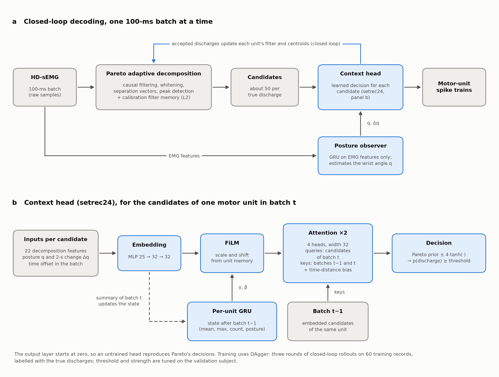

# Pareto-MC

Pareto adaptation with learned discharge decisions, EMG-only posture
estimation and memory local to each recording. **The best system is the context
head trained and run in closed loop (P3). On the held-out subject sub-05, evaluated
once with every system frozen, it reaches 87.38% global RoA and 78.63% on
5-second ramps, against 76.85% and 60.48% for the original method.** On the
validation subject sub-04 it reaches 95.21% and 90.38%. CPU latency remains far
above the 22 ms target.



The work advanced in levels, each building on the previous one:

| Level | What it adds | Global RoA, sub-04 |
|---|---|---:|
| L0 | Exact causal reimplementation of Pareto (Pareto-rerun) | 87.65% |
| L1 | Learned decision head C4, trained in closed loop with DAgger | 91.24% |
| L2 | Calibration-filter memory; accepted development stage | 91.66% (seed mean 91.05%) |
| P1 | EMG-only posture as an input of C4, open loop | 92.01% |
| P2 | Context heads: attention over candidates and a per-unit GRU, open loop | 94.06% (`setrec24`) |
| **P3** | **The `setrec24` context head trained and run in closed loop** | **95.21%** (held-out sub-05: 87.38%) |

P1 to P3 report seed means of three trainings. L3, full memory with insertions
during the recording, is set up but paused. The sections below describe each
level in the order it was developed.

## Development protocol

Development started from `review/robust-mvdr` while PR #1 was open. Training uses
sub-01–03, validation uses sub-04, and sub-05 is reserved. **The change from
Stage B was declared before training:** all conditions and all four SNR levels
are allowed during development. Sub-05 is excluded from tuning and diagnostics.
The [journal](../../docs/benchmarks/pareto_mc_journal.md) records decisions and
deviations.

Phase 0 attempted to start the official NeuroMotion backend from
[MUniverse](https://github.com/dfarinagroup/muniverse), revision
`94fbfab253f037e3b3cbfdbc6aed85b781f0ea49`. Docker's Linux engine was inactive,
and Ubuntu had neither Singularity nor Apptainer. No confirmatory recordings
were generated, so the study remains exploratory. Commands, errors, and hashes
of the Dockerfile and launcher are retained in `phase0.json`.

## Method and limits

The backbone retains the operations of
[`adapt_decomp` a8f5373](https://github.com/imendezguerra/adapt_decomp/tree/a8f53736e297962670276bc123c137050b7056b6),
using
[`optim_muniverse_fdsi_pareto.yaml`](https://github.com/imendezguerra/adapt_decomp/blob/a8f53736e297962670276bc123c137050b7056b6/configs/adapt_configs/optim_muniverse_fdsi_pareto.yaml):
the fixed whitening step `W -= eta_wh (Rz-I) W`, reference FIFO, shrinkage and
clipping, wh→sv coordinate correction, `tanh(y)` contrast only at reliable
discharges, QR, and EMA centroids (0.95). The learning rates are 0.04038249 and
0.002422225. The implementation retains the safeguards omitted from this
abbreviated formula.

This can be interpreted as self-trained tracking of whitened templates. The
trade-off between drift tracking and noise in adaptive filters motivates
state-dependent steps, without guaranteeing a universally optimal step.
See [Widrow et al., 1975](https://doi.org/10.1109/PROC.1975.10036) and
[Kalman, 1960](https://doi.org/10.1115/1.3662552).
In ramp5s, posture repeats approximately eight times. Local memory aims to reuse
filters learned from the recording itself. The method does not assume that
cross-subject morphing with Γ succeeded.

The [FIFO audit](../fifo_audit/README.md) shows the risk of an abrupt amplitude
loss relative to stateful centroids. Mixing is bounded **after QR**; `beta=0`
skips every additional filter operation. Memory stores effective filters
`v=W.T@w` and centroids, with EMA per bin and confidence combining rate,
separation, and IQR. Retrieval uses weighted kernel regression
([Nadaraya, 1964](https://doi.org/10.1137/1109020)). The current batch is inserted
only after retrieval, and memory is never shared between recordings.

The earlier [spike-likelihood improvement](../spike_likelihood/README.md)
motivates learning discharge decisions. Feeding decisions back changes the
training observations; the aggregated rounds follow the principle of
[DAgger, Ross et al., 2011](https://proceedings.mlr.press/v15/ross11a.html).
This motivates the procedure, without establishing the paper's bounds for EMG.

C1 retains GRU(120,24), adds mean and log-variance outputs, and uses Gaussian NLL.
C3 has 159 parameters and bounded outputs; multipliers start at one and beta at
zero. C4 extends the 19→8→1 MLP to 22→8→1 (193 parameters), adding source,
confidence, and estimated velocity. Its final layer starts at zero, so the
untrained decisions and adaptation reproduce Pareto.

## C0 equivalence check

On three real sub-01 records (staircase/ramp10s/ramp5s, 30 dB), **all samples
match, with zero RoA differences from both the original loop and the published
outputs**. The protocol retains the conservative name **Pareto-rerun**. Batch
medians are 38.05/38.48/38.12 ms and p95 values are 46.70/47.21/46.55 ms.
The 22 ms target is unmet with four threads on this machine. These three
training records establish equivalence; their averages are not an external
80-record evaluation.

The operational interface receives raw EMG and a sequential index. Filtering
uses stateful `sosfilt`, and extension uses past samples only. Reference filtering
is also causal: “offline” describes preparation of the recording, rather than
`filtfilt`. The new interface avoids the global mean used by `Data`. Outputs can
be delayed by up to one batch (100 ms); the supplied initial five-second
calibration is allowed. True angles and discharges are opened only in separate
supervision/evaluation functions with subject guards.

## Reproduction

Each run uses a fresh directory to preserve protocols, sealed predictions, and
results. The first L0 attempt in `outputs/pareto_mc/L0` failed because of a
constructor signature mismatch and is retained.

```powershell
$env:PARETO_MC_OUTPUT = 'outputs/pareto_mc/reproduction'
.venv-benchmarks/Scripts/python.exe -m benchmarks.pareto_mc.phase0
.venv-benchmarks/Scripts/python.exe -m benchmarks.pareto_mc.run identity --threads 4
.venv-stage-b-gpu/Scripts/python.exe -m benchmarks.pareto_mc.run train-observer --threads 4
$env:OPENBLAS_NUM_THREADS = '1'
.venv-benchmarks/Scripts/python.exe -m benchmarks.pareto_mc.run identity-head --threads 4
.venv-benchmarks/Scripts/python.exe -m benchmarks.pareto_mc.run l1 --threads 4
.venv-benchmarks/Scripts/python.exe -m pytest benchmarks/pareto_mc -q
.venv-windows/Scripts/python.exe -m ruff check benchmarks/pareto_mc
.venv-windows/Scripts/python.exe -m ruff format --check benchmarks/pareto_mc
```

Training uses `.venv-stage-b-gpu` on the RTX 4070; inference and timing use
`.venv-benchmarks` on CPU. The original constructor emits Intel MKL `SLASWP`
errors when estimating batch KL statistics on Windows. Those statistics do not
scale the steps under `lr_mode=fixed`. Exact agreement is checked on all three
controls despite those messages. The pinned dependency is preserved.

Per-stage diagnostics include true amplitude through `amplitude_metrics`,
centroids, memory hits, control versus estimated velocity, units with recall
below 0.5, and timing distributions. Phases use `angle_phases`. Cycles are
angular excursions above 1° that reach at least 35°, excluding calibration;
they are not constructed from fixed time intervals.

## Development run

**C1 completed 30 epochs**, using seed 0 and selecting the checkpoint at epoch 13
by sub-04 NLL: −1.87788, with a descriptive angular RMSE of 3.2407°. Weights are
in `outputs/pareto_mc/development_v2/C1/seed0/observer.pt`, alongside the original
manifest. Measured angles occur only in the training/evaluation target.

The first L1 run (`development_v1`) is retained. It was superseded before
RoA/Jaccard selection. `development_v2` reuses inputs and a completed checkpoint,
verified in `input_reuse.json`. The training cache preserves the exact arrays
and labels per record, avoiding repeated lag estimation and decompression at
each epoch. Files and provenance have hashes and subject checks.

Torch uses four threads, as in the exact C0 control. Two threads produced seven
differences in one record due to BLAS numerical differences. With four threads,
**untrained C4 again produces zero differences on all three real records**,
including with the trained observer and a single window for KL statistics,
which fixed-step adaptation does not use. Timing under contention in these
checks is separate from an isolated final latency measurement.

L1 aggregates rounds 0–3, with three seeds per round. The checkpoint is selected
by validation BCE. Then 40 TPE trials tune threshold and residual strength by
Jaccard with calibration lags. The best three candidates are repeated with
three seeds and selected by the median. Memory parameters remain inactive
until L2. The acceptance check runs after full-model inference, using the
original evaluator and previously sealed predictions.

If full feedback fails the criteria, one structural alternative is
preregistered: added events may update SV/centroids only when their posterior
is at least 0.8; accepted events remain predictions. This threshold is reachable
with the residual bounded to four; 0.9 was unreachable for new candidates.
If the alternative also fails, L0 is retained and L2–L4 are not run.

Pareto is retained during calibration for batches starting before 5 s, which can
include the remaining fraction of the last batch (about 80 ms). Those timestamps
are not inference labels. The open-loop reference retains exactly the first
five seconds of original predictions.

### L1 completed

**The first structure passes the L1 criteria**, so the alternative was not run.
Sub-04 validation covers 20 records and 124 instances, scored with the original
evaluator:

| Stage | Global RoA | ramp5s | ≥90% | Precision | Recall |
|---|---:|---:|---:|---:|---:|
| Pareto-rerun | 87.65% | 73.88% | 66.94% | 96.06% | 89.03% |
| Open-loop C4 | 90.39% | 81.77% | 70.16% | 95.70% | 92.94% |
| Closed-loop L1 | **91.24%** | **84.71%** | **72.58%** | 96.38% | 93.01% |

**L1 gains 0.84 percentage points globally and 2.94 points on ramp5s over
open-loop C4.** Reference-rest RoA is 97.13%, moving RoA 90.48%, and
away-from-reference plateau RoA 89.98%. The first ramp5s cycle scores 65.89%;
cycles 2–8 score 84.94%. With four concurrent runs, measured latency was
127.92 ms median and 151.32 ms p95. This exceeds 22 ms and is not an isolated
measurement. Results are exploratory development validation, with neither the
external 80-record evaluation nor confirmation on new data completed.

Details, acceptance checks, limits, and hashes are in the
[journal](../../docs/benchmarks/pareto_mc_journal.md) and
[versioned summary](../../docs/benchmarks/pareto_mc_l1/pareto_mc_summary.json).

### L2 method

`memory_loop.py` adds causal retrieval of effective filters and their centroids,
projection into the current whitening coordinates, uncertainty attenuation, and
bounded mixing after QR. In L2, only the calibration snapshot is available.
Zero beta exactly reproduces Pareto on the three real controls and preserves
all L1 state in integration tests.

```powershell
# Requires completed L0, C1, and L1 stages in PARETO_MC_OUTPUT.
.venv-benchmarks/Scripts/python.exe -m benchmarks.pareto_mc.memory_identity "$env:PARETO_MC_OUTPUT/C2_identity_v1"
.venv-benchmarks/Scripts/python.exe -m benchmarks.pareto_mc.shared_identity
.venv-benchmarks/Scripts/python.exe -m benchmarks.pareto_mc.memory_experiment L2 --workers 4
```

The search registers 45 trials, five per structural combination, then repeats
the best three with all three trained C4 seeds. It shares only preprocessing,
whitening, and C1 from the same batch across nine trajectories. A real-data
test requires bitwise equality with independent execution. Search timing is
not treated as inference latency. C4 is then retrained through three DAgger
rounds, and predictions are regenerated with the full CPU loop before checking
the criteria. All records are sealed before their labels are opened.

Bin momentum stays fixed in L2 because there are no insertions; it is searched
in L3. The limiter bounds the memory residual relative to the Pareto proposal.
Retrieved centroids are preserved, while live centroids retain their EMA update.
The journal records these choices and the single permitted alternative after
a failure. The L2 result is established by its saved `gate.json`.

An additional L1 profile with one record at a time measured 56.12 ms median
and 360.87 ms p95, also above 22 ms. Initial C2 tests and measurements are in
`docs/benchmarks/pareto_mc_l2_setup/`.

### L2 completed

**L2 passes its validation criteria with the first structure**, after 45 trials,
three-seed repetitions, and three new DAgger rounds. Sub-04 validation covers
20 records and 124 instances:

| Metric | L1 | L2 |
|---|---:|---:|
| Global RoA | 91.24% | **91.66%** |
| ramp5s RoA | 84.71% | **85.05%** |
| Instances ≥90% | 72.58% | **75.81%** |
| Precision | 96.38% | 95.68% |
| Recall | 93.01% | **94.14%** |
| Reference rest | 97.13% | **97.54%** |
| Moving | 90.48% | **90.94%** |

**L2 meets the reference-rest target of at least 97% and improves movement
accuracy over L1.** Precision is 0.38 percentage points below Pareto, within the
one-point allowance. Ramp5s scores 68.97% on cycle 1 and 85.01% on cycles 2–8.
Memory is active in 4.29% of unit/batch pairs.

CPU timing with four concurrent records is **86.16 ms median and 105.51 ms p95**,
above the 22 ms target. An isolated L2 profile remains pending. **L2 is retained
as the latest accepted development stage.** Results remain exploratory
validation, pending external evaluation and confirmation on new data. The
[versioned result](../../docs/benchmarks/pareto_mc_l2_standard/gate.json) records
the acceptance check and hashes.

### L3 setup and pause

L3 enables reliable insertions into memory bins and keeps calibration immutable.
It starts from the three final L2 checkpoints and adds three DAgger rounds,
also aggregating L1 and L2 trajectories. Bin momentum is now included in TPE.
Before the search, a real-data test requires bitwise equality between independent
and shared execution, including learned bins and their confidence.

```powershell
.venv-benchmarks/Scripts/python.exe -m benchmarks.pareto_mc.full_memory_identity "$env:PARETO_MC_OUTPUT/C2_full_memory_identity_v1"
.venv-benchmarks/Scripts/python.exe -m benchmarks.pareto_mc.full_memory_experiment --workers 4
```

The L3 criteria require global RoA of at least 92.6580%, and ramp5s cycles 2–8
at least five points above cycle 1. If the first structure fails, only the
registered local-confidence alternative is allowed. A second failure stops
progression to later stages.

**L3 has been paused at the user's request since 23 October 2026.** Its identity
checks passed, but the search stopped without scored trials. The study and
pending parameters are saved for an explicitly requested resumption. Publishing
or merging the code does not start experiments. L2 remains the latest accepted
stage; the [pause record](../../docs/benchmarks/pareto_mc_l3_setup/pause.json)
describes the saved state.

### L2 attribution ablation

Before resuming L3, a registered factorial ablation separated L2's components on
the same 20 sub-04 records: the three final L2 C4 seeds with no memory, memory
confidence as a C4 input only, the filter blend only, and the full L2 loop, plus
the L1 head with and without the blend. Before labels were opened, the full L2
arm (seed 2) and the memory-free L1 arm reproduced the sealed L2 and L1
predictions bit for bit.

| Seed-mean variant | Global RoA | ramp5s | Reference rest | Cycles 2–8 |
|---|---:|---:|---:|---:|
| L2 heads, no memory | 91.08% | 85.62% | 94.99% | 86.02% |
| L2 heads, full memory | 91.05% | 85.01% | 97.54% | 84.91% |
| L1 head, no memory | 91.24% | 84.71% | 97.13% | 84.94% |

**Memory is not credited with a global gain:** its effect is −0.03 points, with a
95% cluster-bootstrap interval of [−0.26, +0.23]. The filter blend raises
reference-rest RoA by 1.86 points but lowers ramp5s cycles 2–8 by 1.14 points
[−1.91, −0.46]. Without memory, the retrained L2 heads fall to 94.99% at rest,
below the 97% criterion. Retraining C4 improves the first ramp5s cycle by 3.64
points and recall by 1.32, while lowering precision by 1.66.

The full L2 loop scores 91.20%, 90.29%, and 91.66% with seeds 0, 1, and 2. The
accepted +0.42-point gain over L1 belongs to the selected seed and is smaller
than this 1.37-point seed spread. L3 assumes that blending stored filters helps
repeated cycles; in L2, the blend lowered them. No accepted level changes.

Exact label-free screening also explains the inactive L2 search trials. On the
60 training records, only 8 bins with h=0.03 or h=0.06 blend filters in more
than 2% of batches. Five of the nine structures never blend at any threshold of
at least 0.5. Three of them cannot reach 0.5 even at the reference posture
(maximum mass 0.19–0.36). The calculation matches all 45 sealed search traces
without a single mismatch.

L3's full memory behaves very differently. A registered label-free screen ran
the L3 loop, which writes memory after calibration, on the 30 records of
sub-01 to sub-03 at 30 and 20 dB. It used L3's search head (L2 seed 0),
κ=0.16, beta_max=0.45 and momentum 0.895, for all nine structures at thresholds
0.6 and 0.85. **No structure is inactive.** Every arm blends filters on every
record, in 37–93% of unit-batches, against 0–6% for L2's calibration-only
memory. Blending is most frequent with 8 bins, h=0.03 and threshold 0.6
(92.8%), and least with 32 bins, h=0.12 and threshold 0.85 (36.8%). The screen
excludes no structure from L3's search. It does not measure RoA, and in L2 a
much rarer blend already lowered ramp5s cycles 2–8.

```powershell
$env:PARETO_MC_OUTPUT = 'outputs/pareto_mc/development_v2'
$env:OPENBLAS_NUM_THREADS = '1'
.venv-benchmarks/Scripts/python.exe -m benchmarks.pareto_mc.l2_ablation run --workers 4
.venv-benchmarks/Scripts/python.exe -m benchmarks.pareto_mc.l2_ablation screen
.venv-benchmarks/Scripts/python.exe -m benchmarks.pareto_mc.l2_ablation score
.venv-benchmarks/Scripts/python.exe -m benchmarks.pareto_mc.l2_ablation screen-full --workers 4
```

See the [analysis](../../docs/benchmarks/pareto_mc_l2_ablation/analysis.json),
[reproduction check](../../docs/benchmarks/pareto_mc_l2_ablation/reproduction.json),
[calibration-only screening](../../docs/benchmarks/pareto_mc_l2_ablation/screen_calibration_only.json),
and [full-memory screening](../../docs/benchmarks/pareto_mc_l3_screen/summary.json).

### C1 posture as a C4 input (P1, open loop)

C1 tracks posture well on sub-04: q correlates with the batch angle at r=0.968
(RMSE 3.15°). The current loop does not use this estimate for decisions. C4
receives only |Δq| over 100 ms, which does not separate movement from rest
(AUC 0.518). The predicted log-variance does not track the error either.

P1 retrains C4 with the exact L2 data, labels, recipe, seeds, and TPE, adding
q and its causal 2-second displacement. Before the comparison:

- The memory-free arm reproduced the L2 checkpoint and its TPE selection bit
  for bit.
- The accepted L2 head, decided open loop on its own sealed final candidates,
  reproduced its closed-loop spikes with zero differing samples.

Both arms then decided on those sealed candidates, which neither arm saw
during training or selection.

| Seed-mean arm | Global RoA | ramp5s | Ramp5s cycle 1 | Reference rest | Recall |
|---|---:|---:|---:|---:|---:|
| 22 L2 inputs | 91.53% | 85.10% | 69.54% | 97.53% | 94.21% |
| + posture inputs | **92.01%** | **86.38%** | **71.96%** | **98.20%** | **95.10%** |

**Posture improves open-loop decisions:** +0.49 global points, with a 95%
cluster-bootstrap interval of [+0.08, +0.88], and +1.28 points on ramp5s.
Validation BCE is lower for all three seeds, and every posture seed beats every
baseline seed. The expected mechanism did not hold: the gain is larger near
the reference posture (+1.50 points) than at 20° or more (+0.33, interval
[−0.23, +0.87]). The three lost units remain lost.

This is an open-loop result on one validation subject, without feedback into
adaptation. It meets the registered condition for proposing a closed-loop
level, which has not been run. L2 remains the accepted stage.

```powershell
$env:PARETO_MC_OUTPUT = 'outputs/pareto_mc/development_v2'
.venv-benchmarks/Scripts/python.exe -m benchmarks.pareto_mc.posture_c4 prepare
.venv-stage-b-gpu/Scripts/python.exe -m benchmarks.pareto_mc.posture_c4 train --arm base22 --seeds 0
.venv-stage-b-gpu/Scripts/python.exe -m benchmarks.pareto_mc.posture_c4 train --arm posture24 --seeds 0
.venv-stage-b-gpu/Scripts/python.exe -m benchmarks.pareto_mc.posture_c4 train --arm posture24 --seeds 1
.venv-stage-b-gpu/Scripts/python.exe -m benchmarks.pareto_mc.posture_c4 train --arm posture24 --seeds 2
.venv-stage-b-gpu/Scripts/python.exe -m benchmarks.pareto_mc.posture_c4 select --arm base22
.venv-stage-b-gpu/Scripts/python.exe -m benchmarks.pareto_mc.posture_c4 select --arm posture24
.venv-benchmarks/Scripts/python.exe -m benchmarks.pareto_mc.posture_c4 decide
.venv-benchmarks/Scripts/python.exe -m benchmarks.pareto_mc.posture_c4 score
```

Training memory-maps about 45 GB of candidate caches per epoch. Run it without
concurrent CPU rollouts, and run seeds as parallel processes. See the
[analysis](../../docs/benchmarks/pareto_mc_p1_posture/analysis.json) and
[sealed decisions](../../docs/benchmarks/pareto_mc_p1_posture/decisions_sealed.json).

### C4 context heads (P2, open loop)

The decoding bottleneck is the ranking of candidates within a unit. There are
about 50 candidates per true discharge, and C4's median within-unit AUC is
already 0.985. P1's head judges each candidate on its own, so it sees neither
the competitors in its batch nor the unit's recent history. P2 keeps P1's data,
labels, 24 inputs, seeds, epoch selection and TPE, and changes only the head.
Every head starts at the Pareto prior.

| Arm | Head |
|---|---|
| `wide24` | Per-candidate MLP 24→64→64→1, a capacity control |
| `set24` | Attention over the unit's candidates in the batch and the previous batch |
| `setrec24` | `set24` plus a per-unit GRU across batches that carries the posture trajectory |
| `mdiff24` | `setrec24` trained as masked discrete diffusion over the joint discharge labels (discrete flow matching with a mask source) |

Panel b of the figure at the top of this README shows the `setrec24`
architecture. Each arm decided on L2's sealed final candidates, open loop.
Seed means:

| Arm | Global RoA | ramp5s | ≥20° | Moving | Precision | Recall | Lost units |
|---|---:|---:|---:|---:|---:|---:|---:|
| P1 `posture24` | 92.01% | 86.38% | 86.92% | 91.30% | 95.31% | 95.10% | 3 |
| `wide24` | 92.75% | 88.21% | 88.10% | 92.09% | 95.79% | 95.62% | 2.7 |
| `set24` | 93.06% | 88.23% | 88.74% | 92.45% | 95.68% | 95.99% | 2 |
| `setrec24` | 94.06% | 89.55% | 89.78% | 93.50% | 96.96% | 96.52% | 2 |
| `mdiff24` | **94.19%** | **89.64%** | **90.07%** | **93.64%** | **97.47%** | 96.00% | 2 |

**All four heads beat P1.** Against `posture24`, the gains in global RoA, with
95% cluster-bootstrap intervals, are:

- `wide24`: +0.74 [+0.46, +1.05];
- `set24`: +1.04 [+0.67, +1.47];
- `setrec24`: +2.04 [+1.18, +3.18];
- `mdiff24`: +2.18 [+1.37, +3.24].

**History helps.** `setrec24` beats `set24` by +1.00 [+0.38, +1.94].

**The gain sits where adaptation lags movement.** For `setrec24`:

- +2.85 at 20° or more;
- +3.16 on ramp5s;
- +2.20 while moving;
- none near the reference (+0.04).

This is the mechanism P1 expected but did not find. P1's per-candidate
posture input left the ≥20° stratum unchanged.

**Generative training does not help.** `mdiff24` ties `setrec24`: +0.14
[−0.16, +0.45]. It trades recall for precision, and its validation BCE is
higher (0.0215 against 0.0179). It also costs about 50% more per epoch and
three passes per batch.

A post-hoc split against `wide24`, not registered, attributes the gain over P1
roughly as follows:

- about +0.7 to capacity;
- about +0.3 to batch context;
- about +1.0 to history and the posture trajectory.

The heads depend strongly on their context inputs. These are inference-time
ablations, so they measure reliance, not what a head trained without the
input would reach:

- zeroing the GRU state drops RoA to 39–44%;
- freezing posture costs `setrec24` 12.5 points;
- that posture reliance varies widely by seed (seed 2 falls to 65%).

This is an open-loop result on one validation subject that P1 already used,
with no external evaluation. It met the registered condition for proposing a
closed-loop level. `setrec24` was chosen for it as the simpler candidate, with
fewer feedback paths than `mdiff24`; that level is P3, below.

```powershell
$env:PARETO_MC_OUTPUT = 'outputs/pareto_mc/development_v2'
$env:CUBLAS_WORKSPACE_CONFIG = ':4096:8'
.venv-stage-b-gpu/Scripts/python.exe -m benchmarks.pareto_mc.context_c4 register
.venv-stage-b-gpu/Scripts/python.exe -m benchmarks.pareto_mc.context_c4 train --arm setrec24 --seeds 0 1 2
.venv-stage-b-gpu/Scripts/python.exe -m benchmarks.pareto_mc.context_c4 select --arm setrec24
.venv-stage-b-gpu/Scripts/python.exe -m benchmarks.pareto_mc.context_c4 decide
.venv-benchmarks/Scripts/python.exe -m benchmarks.pareto_mc.context_c4 score --workers 4
```

Repeat `train` and `select` for `wide24`, `set24` and `mdiff24`, one process
per arm. Context heads bound each truncated-BPTT block by a memory budget.
Without that bound, the 8 GB GPU spills into shared memory on Windows instead
of failing. See the [analysis](../../docs/benchmarks/pareto_mc_p2_context/analysis.json),
[sealed decisions](../../docs/benchmarks/pareto_mc_p2_context/decisions_sealed.json)
and [post-hoc contrasts](../../docs/benchmarks/pareto_mc_p2_context/posthoc_vs_wide24.json).

### Context head in closed loop (P3)

P2 decided open loop, on candidates that L2 had already produced. In P3 the
`setrec24` head runs inside the adaptive loop instead: it decides each 100-ms
batch as it arrives, and the discharges it accepts update the unit's filter and
centroids before the next batch (panel a of the figure at the top). Its GRU
state is carried across batches in the stream. A unit test checks that this
streamed head gives the same logits as the batched predictor used for
training.

Running in closed loop changes the candidates the head sees, so it is trained
with DAgger. Each round rolls out the current head on the 60 training and 20
validation records, labels the new candidates with the true discharges, and
retrains on P2's 420 trajectories plus every closed-loop trajectory gathered
so far. There are three rounds. Each keeps P2's recipe: three seeds, AdamW,
three epochs, unit-balanced BCE, and a 40-trial TPE search of threshold and
strength whose top three are repeated with all seeds. The final systems are
the round-3 heads of the three seeds, with threshold 0.384 and strength 0.725.

The median selection objective barely moves across rounds (92.61, 92.96,
92.86), so most of the closed-loop gain arrives in the first two rounds.

Sub-04 validation, 20 records and 124 instances, seed means:

| System | Global RoA | ramp5s | ≥90% | Precision | Recall | Moving | Lost units |
|---|---:|---:|---:|---:|---:|---:|---:|
| Pareto-rerun | 87.65% | 73.88% | 66.94% | 96.06% | 89.03% | 86.72% | 5 |
| L2 | 91.05% | 85.01% | 71.77% | 94.95% | 94.17% | 90.29% | 3.3 |
| P2 `setrec24`, open loop | 94.06% | 89.55% | 81.99% | 96.96% | 96.52% | 93.50% | 2 |
| **P3 `setrec24`, closed loop** | **95.21%** | **90.38%** | **88.71%** | **97.74%** | **96.95%** | **94.75%** | 2.3 |

Registered contrasts, in points, with 95% cluster-bootstrap intervals
(conditions × units, 2000 draws):

| Contrast | Global RoA | ramp5s | ≥90% | Precision | Moving |
|---|---|---|---|---|---|
| P3 − L2 (primary) | +4.16 [2.41, 6.61] | +5.38 [2.62, 8.75] | +16.94 [10.83, 24.29] | +2.78 [1.10, 5.01] | +4.46 [2.60, 7.06] |
| P3 − P2 | +1.15 [0.43, 2.23] | +0.84 [0.22, 1.61] | +6.72 [3.28, 11.11] | +0.78 [0.34, 1.28] | +1.24 [0.48, 2.39] |
| P3 − Pareto | +7.56 [4.86, 10.73] | +16.51 [9.39, 23.39] | +21.77 [13.33, 31.27] | +1.68 [−0.19, 4.17] | +8.03 [5.16, 11.37] |

**P3 improves on L2 in every registered metric, and closing the loop improves
on the same head used open loop.** The largest closed-loop gain is consistency:
6.7 more points of units reach an RoA of at least 90%. All learned systems had
their thresholds tuned on sub-04, so these are development figures. P3 met the
registered rule for entering the held-out evaluation (P3 − L2 above zero).

**Held-out subject sub-05.** Opened once on 12 November 2026 under its own
registered protocol, with Pareto (as published and rerun), the three L2 seeds
and the three P3 seeds, all frozen. 20 records, 140 instances, seed means:

| System | Global RoA | ramp5s | ≥90% | Precision | Recall | Moving | Ramp5s cycle 1 | Lost units |
|---|---:|---:|---:|---:|---:|---:|---:|---:|
| Pareto-rerun | 76.85% | 60.48% | 48.57% | 89.94% | 80.27% | 75.30% | 45.08% | 21 |
| L2 | 80.60% | 68.30% | 56.90% | 88.33% | 85.90% | 79.06% | 56.79% | 13 |
| **P3 `setrec24`, closed loop** | **87.38%** | **78.63%** | **68.10%** | **93.97%** | **90.91%** | **86.27%** | **67.04%** | **5.3** |

| Contrast | Global RoA | ramp5s | ≥90% | Precision | Recall | Lost units |
|---|---|---|---|---|---|---|
| P3 − L2 | +6.78 [4.46, 9.51] | +10.33 [5.60, 16.73] | +11.19 [5.96, 17.76] | +5.64 [3.16, 8.75] | +5.01 [3.26, 7.00] | −7.67 [−14.33, −2.00] |
| P3 − Pareto | +10.53 [7.58, 13.99] | +18.15 [13.70, 22.91] | +19.52 [11.90, 27.69] | +4.03 [1.47, 7.19] | +10.64 [7.87, 13.69] | −15.67 [−24.33, −7.67] |
| L2 − Pareto | +3.75 [1.84, 5.67] | +7.82 [2.44, 12.90] | +8.33 [3.47, 13.47] | −1.61 [−3.79, 0.39] | +5.62 [3.81, 7.48] | −8.00 [−14.34, −2.00] |

**The closed-loop head generalises to the new subject.** Every interval of P3
against L2 and against Pareto lies above zero, and its margins are larger than
on sub-04 (+6.78 against +4.16 points over L2). The three P3 seeds score 88.20%,
86.21% and 87.71%; the three L2 seeds score 80.62%, 79.31% and 81.87%. Sub-05 is
harder for every system: Pareto falls from 87.65% on sub-04 to 76.85%. The
accepted L2 selection (seed 2) gains +5.02 [2.83, 7.32] over Pareto.

The Pareto rerun reproduces the published spikes on 19 of 20 records exactly,
and on the remaining record at 99.9999% of samples. Their metrics differ by less
than 0.01 points. These are simulated recordings from one benchmark; transfer to
another EMG generator or to real recordings is not tested.

**Latency.** The registered measurement processes one sub-04 record at a time
with four Torch threads, on five 20 dB records (4871 batches per system):

| System | Median | p95 |
|---|---:|---:|
| Pareto | 271.3 ms | 1841.2 ms |
| L2 | 294.7 ms | 1922.5 ms |
| P3 `setrec24` | 292.9 ms | 2038.9 ms |

The learned systems add about 20–25 ms of median over Pareto, but all three are
far above the 22 ms target. The cost comes from batches in which Pareto
re-whitens its 1000-dimensional extended signal. On this laptop, the
four-thread oneMKL LU inside `torch.linalg.slogdet` is about 40 times slower than
with one thread (500 ms against 12 ms for a 1000 × 1000 matrix). The same
library prints the `SLASWP` messages noted above. Under fixed-step adaptation
these do not change the decisions, as the identity checks show. An earlier
check on sub-01 at 30 dB measured Pareto at 38 ms, so absolute timings depend
strongly on the record and on the linear-algebra configuration.

```powershell
$env:PARETO_MC_OUTPUT = 'outputs/pareto_mc/development_v2'
$env:PYTHONPATH = '.'
$env:OPENBLAS_NUM_THREADS = '1'
$env:CUBLAS_WORKSPACE_CONFIG = ':4096:8'
.venv-benchmarks/Scripts/python.exe -m benchmarks.pareto_mc.closed_context smoke
.venv-benchmarks/Scripts/python.exe -m benchmarks.pareto_mc.closed_context register
.venv-benchmarks/Scripts/python.exe -m benchmarks.pareto_mc.closed_context run --workers 4
.venv-benchmarks/Scripts/python.exe -m benchmarks.pareto_mc.closed_context latency
.venv-benchmarks/Scripts/python.exe -m benchmarks.pareto_mc.closed_context heldout --workers 4
```

`run` executes the three rounds, the final rollouts and the analysis, starting
the fits and selections in `.venv-stage-b-gpu`. On an 8 GB GPU next to other
applications, train one seed at a time: three parallel fits saturated GPU
memory and system commit on the development laptop. The
[orchestration scripts](../../docs/benchmarks/pareto_mc_p3_closed_context/orchestration/)
used for that schedule call the same registered functions. Set
`KMP_BLOCKTIME=0` and `OMP_WAIT_POLICY=PASSIVE` for multi-process rollouts, but
not for latency. See the [protocol](../../docs/benchmarks/pareto_mc_p3_closed_context/protocol.json),
[analysis](../../docs/benchmarks/pareto_mc_p3_closed_context/analysis.json),
[round selections](../../docs/benchmarks/pareto_mc_p3_closed_context/round3_selected.json),
[latency](../../docs/benchmarks/pareto_mc_p3_closed_context/latency.json),
[held-out protocol](../../docs/benchmarks/pareto_mc_p3_closed_context/heldout_protocol.json)
and [held-out analysis](../../docs/benchmarks/pareto_mc_p3_closed_context/heldout_analysis.json).
