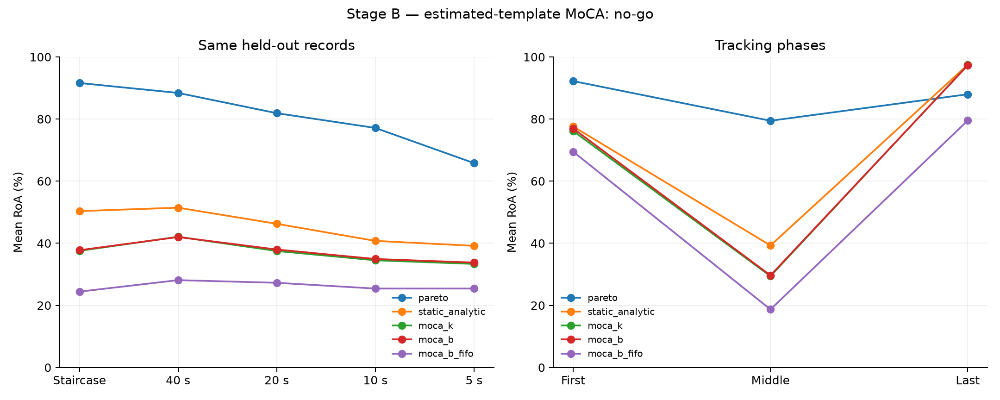

# Stage B: MoCA with kinematics and an EMG-only observer

An independent implementation of shared MUAP morphing and causal state.
**MoCA-K** receives the observed angle; **MoCA-B** estimates that state from EMG.
Both share morphology weights, so the K–B difference measures the cost of
inferring state. Results are recorded in the
[published summary](../../docs/benchmarks/stage_b_summary.json).

## Measured results

**Eight CUDA training runs completed, with 320 predictions saved before
scoring** and all weights frozen. Evaluation covers 80 outer-test records and
591 instances per method.

| Method | Global RoA | 5 s ramps | Final instances ≥90% |
| --- | ---: | ---: | ---: |
| Published Pareto | 80.89% | 65.81% | 511 |
| Analytic static template | 45.56% | 39.17% | 577 |
| MoCA-K, observed angle | 36.97% | 33.34% | 573 |
| MoCA-B, primary | 37.26% | 33.78% | 573 |
| B without online physical shrinkage | 26.11% | 25.41% | 130 |

**MoCA-B did not meet any of the three accuracy thresholds:** 37.26% global RoA
against 85%, 33.78% on ramp5s against 80%, and 0% of instances with global
RoA ≥90% against a required 70%. Mean precision is 92.17% and recall 39.30%;
many discharges are missed. K also fails to improve separation despite receiving
the true state. B's mean angular error per record after calibration is 3.37°,
rising to 5.32° on ramp5s.

**Final-rest recovery reaches 97.32% RoA and 573 instances at or above 90%** in the
last five seconds, with 74 gained and 12 lost relative to Pareto. The static
template reaches 577, so this recovery does not establish an improvement from Γ.
Physical shrinkage improves B by 11.15 points over pure FIFO. The learned
correction loses 8.30 points relative to the static control.

The CPU core has a median of per-record batch medians of 10.92 ms and a median
of per-record p95 values of 20.01 ms. Measurements use up to four concurrent
processes and already projected inputs; complete latency is unverified. GPU
training takes 33.97–41.52 seconds per run.

The [summary](../../docs/benchmarks/stage_b_summary.json),
[per-instance metrics](../../docs/benchmarks/stage_b_per_unit.csv),
[descriptive analysis](../../docs/benchmarks/stage_b_analysis.json), and
[audit](../../docs/benchmarks/stage_b_audit.json) retain the result.
All 591 Pareto rows exactly reproduce the preceding experiment, including
phase metrics. Weights and predictions were not retuned after this result.



## Implemented theory

Each multichannel template comes from its unit's initial five-second calibration
discharges. It is energy-normalized and processed as a volume of 64 samples
across 10×10 electrodes. A spatiotemporal CNN with two
[FiLM](https://arxiv.org/abs/1709.07871) blocks computes

\[
\widehat h_i(q)=h_{i,cal}+\operatorname{clip}_{\|\cdot\|_2\le2}
\{q\,\Gamma_\theta(h_{i,cal},q)\}.
\]

The initial output is the identity and correction is zero at `q=0`. Γ's
3,137 parameters are shared across subjects and units, without trainable vectors
per identifier. The energy bound, weight decay, and input perturbation regularize
model size; they do not establish generalization.

The predicted waveform is converted to the benchmark's lag ordering and
projected onto 512 calibration axes. The separator is computed analytically:

\[
w_i=\frac{R^{-1}\widehat h_i}
{\sqrt{\widehat h_i^\top R^{-1}\widehat h_i}},\qquad
R=0.5R_{FIFO}+0.5\left(\sum_i\widehat\lambda_i\widehat h_i
\widehat h_i^\top+\sigma^2I\right)+\epsilon I.
\]

For a fixed template and positive covariance, this direction maximizes
`(wᵀh)²/(wᵀRw)`: whitening by R and applying Cauchy–Schwarz gives `w ∝ R⁻¹h`.
The normalization sets `wᵀRw=1`. This holds for the estimated template and
covariance; separation can still fail when identities are estimated incorrectly.
The approximation and its generalization are evaluated experimentally.

The implementation uses shared Cholesky, a ten-batch FIFO, and a causal rate
estimated from accepted discharges. PCA basis and gains stay fixed after
calibration. The original SD detector is retained, with no Pareto fallback after
the first five seconds or new units. Updates use the current and past batches,
each about 100 ms long. Original preprocessing includes offline filtering, so
causality from raw EMG is not established.

For K, `q=angle/40`. For B, a 10,537-parameter GRU receives 120 variables:
100 channel log RMS values, 16 log covariance eigenvalues, and four statistics
from fixed sources in the **previous** batch. Normalization uses calibration
only. Angle is a training label and never an input to the B observer. Its output
is scalar; it receives neither true velocity nor absolute time. Random circular
starts during training reduce reliance on the protocol clock.

## Supervision and differences from the research guide

FDSI contains clean/noisy EMG, angles, and discharge times, but lacks the
generator's original MUAP trajectories. Γ targets are therefore **true-discharge
triggered averages of clean EMG**, in nine posture neighborhoods with at least
twenty events. Unit alignment uses calibration only. Targets contain estimation
error and interference, so they are not true MUAPs.

This variant uses post-calibration labels from training and validation subjects,
unlike the preceding experiments without such training labels. It minimizes
normalized waveform error plus 0.1 temporal-derivative error and 0.001 correction
energy. Joint EMG reconstruction/BCE optimization and optional peel-off are not
implemented.

Covariance is approximated in 512 dimensions. Frozen Γ is evaluated at
129 postures during initialization, then its projection is interpolated. This
table depends on calibration and weights, with no future signals. The audit
compares interpolation against direct Γ. Table creation is timed separately
from the per-batch core. Capturing high PCA variance does not establish
preservation of all unit identities.

## Protocol and generalization

The same 80 records and 591 calibrated instances from preceding experiments are
retained. For each outer subject, `sub-02` through `sub-05`, the next cyclic
subject provides validation and the other three train; `sub-01` always trains.
Only staircase, ramp40s, and ramp10s enter fitting: SNR 30/20 for training and
25 for selection. Ramp5s, ramp20s, and 15 dB are excluded from fitting and
weight selection. Each model excludes its own outer subject's labels. In
cross-validation, an outer subject in one fold can train another; some label
files have therefore been read elsewhere before inference.

The fixed budget uses two seeds, twenty Γ epochs, and thirty observer epochs,
with epoch zero eligible. Each branch selects its checkpoint by its validation
objective, without outer-test RoA. Templates from both seeds are averaged;
each observer retains its own state. Eight training runs and sixteen checkpoints
are frozen before outer inference. All four new methods save their
320 predictions before scoring begins.

Comparators are published Pareto, a static template with analytic inverse,
MoCA-K, primary MoCA-B, and B without model shrinkage in the online covariance.
Instances and the original evaluator are retained: 2 ms tolerance and original
per-unit alignment. Phases are aligned separately, following the earlier work.
Reported metrics include precision, recall, F1, SIL, final retention, and
post-calibration angular error.

The protocol saves code and PDF hashes, a source snapshot, selected weights, and
a prediction manifest. P1 had already been examined in preceding work, so this
is exploratory grouped transfer within the same generator.

## GPU training and CPU inference

Training uses **CUDA on the 8 GB RTX 4070 Laptop**, PyTorch 2.7.0 with CUDA 12.6,
float32 without AMP/TF32, fixed seeds, and deterministic algorithms. The existing
CPU environment is retained. The partial CPU attempt remains in
`outputs/stage_b_main/aborted_cpu_v1/`, with source, protocol, and histories;
its weights do not participate in the GPU run. The device changed before scoring
outer-test Stage B models.

Install with uv in PowerShell:

```powershell
uv venv .venv-stage-b-gpu --python .venv-benchmarks/Scripts/python.exe
uv pip install --python .venv-stage-b-gpu/Scripts/python.exe torch==2.7.0+cu126 --index-url https://download.pytorch.org/whl/cu126
uv pip install --python .venv-stage-b-gpu/Scripts/python.exe -r benchmarks/stage_a/requirements.lock.txt
.venv-stage-b-gpu/Scripts/python.exe -c "import torch; print(torch.__version__, torch.cuda.get_device_name(0))"
```

The CUDA distribution follows the
[official PyTorch 2.7.0 instructions](https://pytorch.org/get-started/previous-versions/#v270).
Other dependencies retain their earlier versions. The NVIDIA driver is
unchanged. `train` requires CUDA and fails if it is missing; evaluation loads
weights on CPU.

```powershell
# For a fresh output directory: write targets once per subject.
foreach ($subject in 'sub-01','sub-02','sub-03','sub-04','sub-05') {
  .venv-benchmarks/Scripts/python.exe -m benchmarks.stage_b.run targets --subject $subject
}
.venv-benchmarks/Scripts/python.exe -m benchmarks.stage_b.run register
foreach ($subject in 'sub-02','sub-03','sub-04','sub-05') {
  foreach ($trialSeed in 0,1) {
    .venv-stage-b-gpu/Scripts/python.exe -m benchmarks.stage_b.run train --subject $subject --seed $trialSeed
  }
}
.venv-benchmarks/Scripts/python.exe -m benchmarks.stage_b.run freeze
.venv-benchmarks/Scripts/python.exe -m benchmarks.stage_b.run audit
foreach ($subject in 'sub-02','sub-03','sub-04','sub-05') {
  .venv-benchmarks/Scripts/python.exe -m benchmarks.stage_b.run predict --subject $subject
}
.venv-benchmarks/Scripts/python.exe -m benchmarks.stage_b.run seal
.venv-benchmarks/Scripts/python.exe -m benchmarks.stage_b.run score
.venv-benchmarks/Scripts/python.exe -m benchmarks.stage_b.run report
```

Output defaults to `outputs/stage_b_main`. `STAGE_B_OUTPUT` selects a different
directory to preserve previous experiments. Registration refuses to overwrite
an existing protocol. Compact results are copied to `docs/benchmarks/stage_b_*`;
large data and weights remain ignored.

The [GPU lock](requirements-gpu.lock.txt) records installed versions. After
`report`, `python -m benchmarks.analyze_stage_b` exports a descriptive comparison
by phase, subject, condition/noise, and state error. It changes no parameters
or selection.

In the recorded execution, the first subject was scored serially. The other
three were distributed with `python -m benchmarks.score_stage_b_partition sub-03`
and its equivalents. That scheduler restricts only the subject loop of the
frozen evaluator. Each process verifies the complete manifest and saves hashes
for its twenty results; the report requires all eighty records. The
[distribution record](../../docs/benchmarks/stage_b_scoring_schedule.json)
retains the schedule, with the same weights, metrics, and thresholds.

After scoring, `python -m benchmarks.diagnose_stage_b` examines two
training/validation records from the frozen model for `sub-02`. It compares
waveform error with error in the projected central template and scores the same
models without retraining. The
[diagnostic](../../docs/benchmarks/stage_b_training_diagnostic.json) is
descriptive and selects no replacement variant.

## Acceptance criteria

For B, the guide requires global RoA ≥85%, ramp5s ≥80%, and at least 70% of
instances with RoA ≥90%. It also requires complete CPU inference within
22 ms per batch and a decline of at most ten points between 8 and 40 degrees/s.
FDSI lacks new 1/2.5 s ramps and their true trajectories; resampling is not used
as a substitute. Recorded timing excludes projection and feature extraction.
Even if all three accuracy thresholds pass, the full evaluation remains
incomplete until those tests run. A failure on accuracy rules out acceptance.

The audit checks that changing all true angles leaves B identical, perturbing
future signals preserves the prefix after preprocessing, and the table has
less than 1% relative error against direct Γ for projected templates of the
audited training record. This does not establish causal offline filtering or
generalization beyond the generator.
