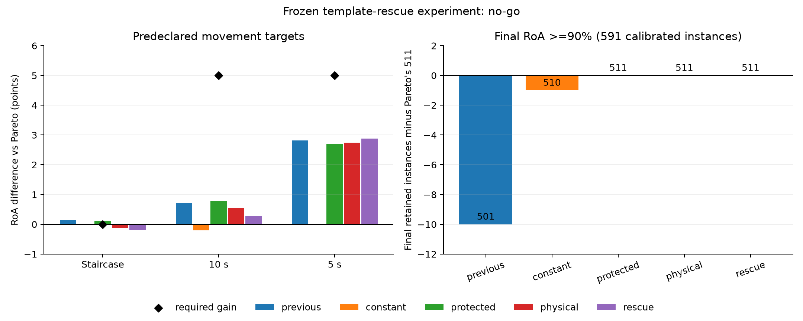

# Recuperación con plantillas multicanal y respaldo de Pareto

Experimento posterior al residual de 97 parámetros. Su objetivo es contrastar
tres mecanismos: direcciones físicas de corrección adicionales, reidentificación
de unidades inactivas y conservación de las descargas al regresar a la postura
de calibración. Incluye una corrección constante seleccionada sin RoA como
control de la utilidad del condicionamiento aprendido.

Este es un **control analítico inspirado en MoCA-K**, no una implementación
completa de MoCA, una nueva ejecución del Stage A ni un modelo ciego. Usa ángulo
medido. No implementa todavía la red convolucional FiLM de deformación del
documento guía, supervisión con trayectorias MUAP verdaderas, covarianza FIFO
completa, peel-off ni nuevas unidades no presentes en calibración.

## Fundamento y decisiones anteriores al test

El documento guía, §§5.2–5.4 y algoritmo 1, propone representar explícitamente
los MUAP y sintetizar filtros a partir de la mezcla. El modelo de señal es
una suma de trenes de descargas convolucionados con MUAP multicanal variables.
La adaptación de esta mezcla es también el problema del
[benchmark de Mendez Guerra et al.](https://doi.org/10.1088/1741-2552/ad5ebf).
La teoría de inversión y sus errores por semejanza entre MUAP, ruido y
condicionamiento se desarrolla en
[Klotz y Rohlén](https://arxiv.org/abs/2502.04065).
La creación, búsqueda y actualización de plantillas tiene precedentes en
[Nawab et al.](https://pmc.ncbi.nlm.nih.gov/articles/PMC2932793/).
Estas fuentes justifican mecanismos; no prueban la eficacia de este experimento.

### 1. Plantillas y nuevas direcciones

Se blanquean espacialmente los 100 canales con la covarianza de calibración:

`S = (C_cal + 0.05 trace(C_cal)/100 I)^(-1/2)`.

Luego se usan los diez retardos originales, dando 1.000 coordenadas. Es una
aproximación separable de la covarianza, diferente del blanqueamiento adaptativo
completo de Pareto, que permanece como rama independiente. Las plantillas `H0_j`
son promedios del EMG extendido en las descargas predichas de calibración. Son
estimaciones multicanal alineadas a esos picos, no MUAP verdaderos del simulador
ni necesariamente su forma temporal completa.

Con `q = (ángulo - ángulo de calibración)/40`, se ajusta en línea

`H_j(q) = H0_j + q B_j`.

El ajuste de `B_j` resuelve una regresión ridge mediante estadísticas suficientes,
con pseudoconteo 20. Solo incorpora picos previos de Pareto cuya similitud con
la plantilla retenida supera un umbral de calibración; la decisión del lote se
emite **antes** de incorporar sus observaciones. `H0` nunca se sobrescribe y
`||H_j(q)-H0_j|| <= 0.5 ||H0_j||`. La dependencia lineal en el ángulo es una
hipótesis local con capacidad limitada, no una ley fisiológica demostrada.

Con las columnas de `H` normalizadas, los filtros son

`F(H) = H (H.T H + 0.1 I)^(-1)`.

Es el inverso regularizado del modelo de covarianza `H H.T + 0.1 I`, mediante
una resolución pequeña compartida por unidades. Su matriz tiene autovalores
al menos 0,1, lo que asegura una resolución única. No demuestra identificabilidad
de todas las unidades, invertibilidad global del sistema ni mejora de RoA.

La dirección física añadida al residual previo es

`r = z [F(H(q)) - F(H0)] gain_cal`.

Su RMS por unidad se limita a 0,25 veces el RMS de la fuente de calibración.
Así se ensayan direcciones multicanal que no están restringidas a la recta
entre los filtros fijo y Pareto. La cota RMS es una cota de desplazamiento de
salida por lote; no garantiza menor error de descargas.

### 2. Recuperación explícita

Un detector independiente recibe las fuentes de `F(H(q))`, con amplitudes y
centroides estimados únicamente en calibración. Retiene la plantilla de una
unidad aunque Pareto no produzca picos de ella. Puede proponer una descarga
si la rama principal lleva al menos 250 ms sin detectar esa unidad y se cumplen:

- evidencia multicanal superior al percentil 10 de sus picos de calibración;
- similitud mayor que con las demás identidades calibradas; los empates se rechazan;
- distancia mínima original de 10 ms respecto a descargas emitidas, también
  entre lotes y respecto a picos principales del lote actual.

No se obliga a disparar a una unidad ausente: sin evidencia no se añade nada.
El mecanismo no depende de que la pérdida de contraste proporcione gradiente
a una unidad inactiva. Es una decisión de búsqueda/detección, no una nueva
pérdida diferenciable de recuperación. Se miden sus posibles falsos positivos.

### 3. Protección de la postura de referencia

La corrección neuronal anterior y la dirección física se multiplican por
`clip((|q|-0.025)/0.1, 0, 1)`. Si `|q|<=0.025` y la velocidad normalizada
`|v|<=0.1`, se devuelven las descargas originales de la **rama Pareto completa**.
Los centroides alterados del detector secundario no intervienen en ese respaldo.
La condición depende de cinemática actual, nunca del nombre de la condición,
la duración conocida del registro ni etiquetas futuras.

Se comprueba igualdad exacta con Pareto en las muestras respaldadas. Esto no
garantiza ausencia de regresión en posturas estáticas alejadas de la calibración,
en las transiciones ni en cualquier fase final de otros datos.

## Comparación y generalización

Se mantienen los cuatro sujetos externos `sub-02..05` y sus mismos 80 registros,
591 instancias calibradas. Los ocho modelos neuronales anteriores conservan sus
pesos y combinan las dos semillas como antes. No se reentrena una red nueva.
La regresión de plantillas es una adaptación causal al registro, regularizada
y basada en predicciones, no en descargas verdaderas posteriores a calibración.

En cada partición se comparan constantes `[0, -0.075, -0.15, 0.075, 0.15]`
usando las tres condiciones de validación del estudio anterior a 25 dB y un
sujeto distinto del externo. Se aplica el mismo replay y objetivo sin etiquetas,
con cero elegible, mejora mínima del 0,5% y regresión por condición máxima 0,01.
No se selecciona una constante por RoA. El sujeto original de ajuste de Pareto,
`sub-01`, nunca se presenta como externo. 5 s, 20 s y 15 dB no participan en
la selección. La red anterior conserva su entrenamiento original.

| Método | Función |
| --- | --- |
| `pareto` | Referencia original completa |
| `previous` | Residual neuronal anterior, pesos y predicciones conservados |
| `constant` | Corrección constante con selección sin etiquetas |
| `protected` | Red anterior con atenuación y respaldo de referencia |
| `physical` | `protected` más dirección física, sin rescate de descargas |
| `rescue` | Variante principal: `physical` más recuperación explícita |

El método principal se fija antes de puntuar y no se sustituye por la mejor
ablación al ver el RoA. Criterios: +5 puntos en cada rampa 5/10 s, ninguna pérdida
en escalera, fase final y unidades finales ≥90%, mejora media estricta y ninguna
pérdida a 15 dB. Se conserva la tolerancia de 2 ms y alineación del evaluador
original, incluida su realineación separada por fase.

**Todos los resultados originales ya se examinaron.** Este estudio es exploratorio;
la separación por sujeto impide ajuste directo con ese sujeto, pero no elimina
la exposición previa del diseño al benchmark. Nuevos registros reservados y
otros generadores o datos humanos son necesarios para confirmación independiente.
No se usa ELMo ni se atribuye a su trabajo sobre texto evidencia sobre EMG.

## Reproducción y controles

Usar `.venv-benchmarks`, los datos existentes y el estudio residual anterior.
Para otra ejecución, definir antes `TEMPLATE_RESCUE_OUTPUT` con otra carpeta.

```powershell
.\.venv-benchmarks\Scripts\python.exe -m pytest -q benchmarks/template_rescue/test_rescue.py
.\.venv-benchmarks\Scripts\python.exe -m benchmarks.template_rescue.run audit
.\.venv-benchmarks\Scripts\python.exe -m benchmarks.template_rescue.run register
.\.venv-benchmarks\Scripts\python.exe -m benchmarks.template_rescue.run select
.\.venv-benchmarks\Scripts\python.exe -m benchmarks.template_rescue.run predict
.\.venv-benchmarks\Scripts\python.exe -m benchmarks.template_rescue.run score
.\.venv-benchmarks\Scripts\python.exe -m benchmarks.template_rescue.run report
.\.venv-benchmarks\Scripts\python.exe -m benchmarks.analyze_template_rescue
```

`predict --subject sub-02` permite generar una partición; después de las cuatro
se usa `seal` antes de `score`. Los 320 archivos nuevos de predicciones se sellan
antes de abrir las etiquetas para puntuar el primero. Las predicciones neuronales
anteriores se comparan sin modificación. Se registran hashes de código,
protocolo, modelos previos, calibraciones, señales, ángulos y predicciones.

Las pruebas numéricas cubren el inverso regularizado frente a la resolución
densa, canales degenerados, anclaje y cota del morfismo, permutación de unidades,
rechazo de identidades ambiguas, recuperación con evidencia y refractario entre
lotes. Una perturbación real de lotes futuros comprueba que las primeras
24.480 muestras de fuentes, evidencia y descargas permanecen idénticas.
La causalidad es por lotes de 100 ms **después del preprocesamiento offline**
original; no se afirma un preprocesador de EMG completamente online.

El tiempo de la rama adicional excluye la adaptación Pareto, preprocesamiento
y lectura de disco. No acredita la latencia completa de MoCA del documento.
Los resultados y fallos se conservan en el [resumen](../../docs/benchmarks/template_rescue_summary.json).

## Resultado ejecutado

**NO-GO.** En los 80 registros externos, RoA medio 81,4166% frente a 80,8885%
de Pareto y 81,6896% del residual anterior. Rampa 5 s: +2,8785 puntos frente
a Pareto; 10 s: +0,2665; escalera: −0,1845; 15 dB: +1,0239. Se conservan
511 instancias finales ≥90%, igual que Pareto y frente a 501 del residual previo.
La fase final pierde 0,00025545 puntos, por lo que también falla la condición
estricta de ausencia de pérdida. Los umbrales originales permanecen vigentes.

| Variante | RoA medio (%) | Instancias finales ≥90% |
| --- | ---: | ---: |
| Pareto | 80,8885 | 511 |
| Residual anterior | **81,6896** | 501 |
| Constante seleccionada | 80,8121 | 510 |
| Protección | 81,6706 | **511** |
| Protección + dirección física | 81,4984 | 511 |
| Principal con recuperación | 81,4166 | 511 |

La protección evita la pérdida de instancias finales introducida por el modelo
anterior. La dirección física pierde 0,1723 puntos respecto a la protección;
añadir recuperaciones pierde otros 0,0818. El rescate incorpora 6.792 eventos:
con la alineación propia de cada método, +2.082 TP netos y +4.710 FP netos.
Son cambios agregados, no etiquetas independientes de cada evento añadido.
La precisión media cae de 91,0366% a 90,1264% frente a la rama sin rescate.
Esta estimación lineal de plantilla y sus controles de identidad son insuficientes.

El análisis del borde final encuentra cinco muestras-tiempo distintas de Pareto,
en cinco instancias de cuatro registros, dentro de los primeros 54 ms de la fase.
La envolvente ya vale cero pero el respaldo exige además velocidad pequeña;
ese primer lote conserva un detector previamente alterado. No se modifica ese
umbral después de ver el test. No se declara GO mediante redondeo ni se sustituye
el método principal por una ablación.



Las 51 pruebas del benchmark pasan. Los resultados son exploratorios y no
constituyen evidencia independiente fuera de estos datos. Ver
[resumen](../../docs/benchmarks/template_rescue_summary.json),
[análisis por componente](../../docs/benchmarks/template_rescue_analysis.json)
y [diagnóstico de fronteras](../../docs/benchmarks/template_rescue_boundary.json).
