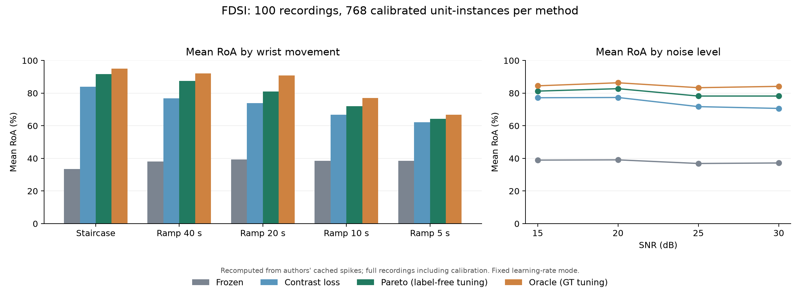

# Reproducción FDSI: semanas 1–2

Esta fase descarga los datos y reproduce las cifras de filtros fijos, Pareto
y oracle desde las salidas publicadas por los autores. El criterio de salida es una diferencia máxima de
**±1 punto porcentual respecto a la tabla 2**, página 7. También se incluye la
configuración de pérdida de contraste para verificar la tabla completa.

Estado: **COMPLETADO; criterio de salida superado**.
Ejecución final: **18 de octubre de 2026, 11:16 CEST (09:16 UTC)**.

## Resultados observados

Se descargaron y verificaron los **21.096.313.946 bytes** de los dos archivos
oficiales. Se comprobaron los 100 registros y las 100 calibraciones, y se
recalcularon los **400 resultados**, con **768 instancias de unidades por método**
(3.072 puntuaciones en total). La diferencia máxima entre cada RoA guardado y
recalculado fue **0,0**.

| Método | RoA medio observado (%) | Tabla 2 (%) | Mediana (%) | Unidades con RoA ≥90% (%) |
| --- | ---: | ---: | ---: | ---: |
| Fijo | 37,58 | 37,6 | 34,76 | 0,00 |
| Pérdida de contraste | 72,69 | 72,7 | 84,94 | 44,27 |
| Pareto | 79,25 | 79,3 | 95,03 | 57,68 |
| Oracle | 84,30 | 84,3 | 96,99 | 68,49 |

**28/28 valores de la tabla 2 y 15/15 valores de la figura 2 pasan** el umbral de
±1 punto porcentual. La mayor diferencia con la tabla 2 es **0,0544 puntos**;
con la figura 2, **0,0548 puntos**. Las comparaciones utilizan los valores sin
redondear, disponibles en [el registro de ejecución](fdsi_cached_summary.json) y
[el CSV de aceptación](fdsi_table_2_checks.csv).

En las rampas de 5 s, Pareto alcanza **64,17195%** y oracle **66,76235%**: esta
reproducción confirma las cifras de partida del plan para las fases siguientes.



### Observación sobre la interpretación del ruido

| SNR (dB) | Instancias calibradas por método | RoA fijo (%) | Contraste (%) | Pareto (%) | Oracle (%) |
| --- | ---: | ---: | ---: | ---: | ---: |
| 15 | 71 | 38,96 | 77,18 | 81,25 | 84,50 |
| 20 | 127 | 39,11 | 77,34 | 82,74 | 86,36 |
| 25 | 238 | 36,88 | 71,73 | 78,22 | 83,34 |
| 30 | 332 | 37,19 | 70,63 | 78,22 | 84,16 |

Los cuatro SNR contienen 25 registros cada uno, pero la selección supervisada
conserva muchas menos unidades al aumentar el ruido. Por tanto, las medias por
SNR se calculan sobre conjuntos seleccionados distintos. **Inferencia de esta
revisión:** la estabilidad de esas medias, por sí sola, no demuestra que el ruido
no afecte al rendimiento o al número de unidades recuperables. La reproducción
numérica de la tabla sí queda confirmada.

## Fuentes y alcance

- Código oficial: [imendezguerra/adapt_decomp](https://github.com/imendezguerra/adapt_decomp),
  revisión `a8f53736e297962670276bc123c137050b7056b6`, sin modificaciones.
- Señales: [Zenodo 22882346](https://doi.org/10.5281/zenodo.22882346),
  `adapt_decomp-fdsi_benchmark-data.zip`, 10.346.978.220 bytes,
  MD5 `1b146ef935f2bc04a615aa92542e350a`.
- Resultados: [Zenodo 22882323](https://doi.org/10.5281/zenodo.22882323),
  `adapt_decomp-fdsi_benchmark-outputs.zip`, 10.749.335.726 bytes,
  MD5 `75e86229423b8e432391125f7e311908`.
- Protocolo y agregación: `configs/data_configs/fdsi_benchmark_grid.yaml` y
  `notebooks/fdsi_benchmark/05_comparison_sv_loss_pareto_roa.ipynb` del checkout
  oficial. Los objetivos de comparación se transcriben por separado de la tabla 2;
  los resultados observados proceden de las predicciones descargadas.

Se descargan los dos ZIP completos, se verifican sus checksums y se conservan
junto a sus contenidos extraídos en `data/benchmarks/farina/`, ignorado por Git.
Se necesitan aproximadamente **42,2 GB** para ZIP y archivos extraídos, además del
entorno Python. El tutorial de 190 segundos ya existente pertenece a otro
protocolo y sus cifras no sustituyen este benchmark.

Esta fase evalúa predicciones publicadas. No vuelve a entrenar la calibración,
buscar hiperparámetros ni ejecutar la adaptación; tampoco implementa Stage A,
MoCA, difusión o síntesis EMG con MyoHand. Esas tareas corresponden a fases
posteriores del plan.

## Protocolo conservado

1. Cinco sujetos simulados × cinco movimientos × cuatro SNR = **100 registros**;
   adicionalmente, 25 señales limpias. Muestreo a 2048 Hz y 100 canales.
2. Calibraciones publicadas de los primeros 5 s, extensión 10, selección
   supervisada de unidades con RoA de calibración ≥90%, siguiendo la comparación
   inclusiva del código oficial (`select_supervised`), aunque el informe escribe >90%.
3. Comparación de `frozen`, `contrast`, `pareto` y `oracle`, usando exclusivamente
   la rama `lr_fixed`. La referencia fija desactiva blanqueamiento, vectores de
   separación y detección adaptativos.
4. Se comprueban dimensiones, orden de identidades y RoA guardado. Cada RoA se
   vuelve a calcular con `rate_of_agreement_paired` del código oficial, usando
   las predicciones y las descargas reales simuladas. Una discrepancia superior
   a `1e-10` entre RoA guardado y recalculado detiene la ejecución.
   En tres cachés oracle del pool de ajuste falta el campo opcional de identidades:
   se utiliza el orden de su calibración, como en el cuaderno oficial, sin volver
   a emparejar unidades. Las puntuaciones recalculadas coinciden exactamente
   también en esos tres archivos; se registra este origen en CSV y procedencia.
5. Para igualar la tabla 2 se evalúa **todo el registro, incluida la calibración**,
   con tolerancia de picos de 2 ms y búsqueda del retardo global de ±40 ms por
   unidad. Es una evaluación retrospectiva, distinta de una evaluación causal
   con retardos congelados en calibración.
6. La media, mediana y proporción con RoA ≥90% se calculan sobre **768 instancias
   de unidades por método**. No se promedian primero los registros ni se cuentan
   como 768 unidades biológicas diferentes. La cobertura incompleta, los
   duplicados y los valores no finitos producen un error.
7. Se contrastan los 28 valores de la tabla 2 y los 15 valores de la figura 2
   correspondientes a fijo/Pareto/oracle, con tolerancia de ±1 punto porcentual.

El ajuste Pareto utiliza pérdidas sin etiquetas, pero la selección inicial de
unidades sí emplea etiquetas de simulación. **Oracle utiliza etiquetas para el
ajuste de hiperparámetros** y debe interpretarse como comparador diagnóstico.
Los tres registros de ajuste son `sub-01`, 30 dB, rampas de 40/10/5 s. La
evaluación sobre los 100 registros incluye ese pool, como en el protocolo P1
del informe; no acredita generalización a sujetos no vistos.

Las configuraciones de adaptación descargadas incluyen `device: cpu` y
`device: cuda`. Los tensores de predicción se guardaron en CPU y se evalúan aquí
en CPU. No se
reutilizan sus tiempos guardados como una medida de latencia en esta máquina;
esta reproducción no verifica el objetivo posterior de 22 ms por lote.

## Repetir en Windows

Desde la raíz del repositorio:

```powershell
powershell -NoProfile -ExecutionPolicy Bypass -File benchmarks/farina/setup.ps1 -Fdsi
.\.venv-benchmarks\Scripts\python.exe benchmarks/farina/download.py fdsi-data --workers 32
.\.venv-benchmarks\Scripts\python.exe benchmarks/farina/download.py fdsi-outputs --workers 32
.\.venv-benchmarks\Scripts\python.exe benchmarks/farina/reproduce_fdsi.py --threads 4
.\.venv-benchmarks\Scripts\python.exe benchmarks/farina/plot_fdsi.py
.\.venv-benchmarks\Scripts\python.exe -m pytest -q benchmarks/farina/test_metrics.py benchmarks/farina/test_fdsi.py benchmarks/farina/test_download.py
```

El descargador reanuda tanto bloques completos como bloques parcialmente
recibidos. La extracción solo comienza tras verificar el checksum del archivo
completo. El parámetro `--workers` puede reducirse si la conexión lo necesita.

`setup.ps1 -Fdsi` utiliza `requirements-fdsi.lock.txt` en el entorno de benchmarks;
conserva las versiones numéricas del tutorial. Las dependencias del simulador,
`pyproject.toml` y `uv.lock` permanecen independientes.

## Artefactos de ejecución

La CLI guarda en `outputs/farina/fdsi_cached/`:

| Archivo | Contenido |
| --- | --- |
| `summary.json` | Estado de aceptación, cifras, diferencias, protocolo, versiones y checksums de las fuentes. |
| `per_unit.csv` | RoA guardado/recalculado, identidad y retardo de cada instancia y método. |
| `table_2_checks.csv` | Los 28 valores objetivo frente a los observados y su diferencia en puntos. |
| `by_condition.csv` | RoA medio por movimiento y método. |
| `inventory.json` | Dimensiones, número de unidades e identidades de los 100 registros. |
| `cache_provenance.json` | SHA-256 de las 100 calibraciones y 400 resultados; configuraciones de adaptación. |
| `comparison.png` | Figura regenerada desde las cifras calculadas. |

Las salidas grandes permanecen ignoradas por Git. Una copia del registro de
resultados, el CSV de aceptación y la figura están conservados en `docs/`.

## Verificación de la herramienta

18 pruebas pasan en el entorno de benchmarks: puntuación de picos uno a uno,
aplicación del retardo antes del recorte temporal, promediado por instancias,
rechazo de coberturas incompletas/duplicadas y RoA inválido, umbral inclusivo de
±1 punto, lectura de dimensiones y reanudación de descargas interrumpidas con
verificación previa a la extracción; además, el campo opcional de identidades
puede faltar, pero un orden explícito contradictorio se rechaza. La revisión de
estilo con Ruff pasa en `src`, `scripts`, `tests` y `benchmarks/farina`.

La suite del simulador también pasa: **46 pruebas, una prueba gráfica omitida**.
En total se verificaron **64 pruebas correctas y una omitida**. El entorno de
benchmarks usa Python 3.12.14 y PyTorch 2.7.0+cpu. La ejecución final de la CLI
tardó 494,29 s, incluida la nueva comprobación de checksums y la evaluación de
las cachés; ese tiempo no mide la latencia de descomposición del algoritmo.
